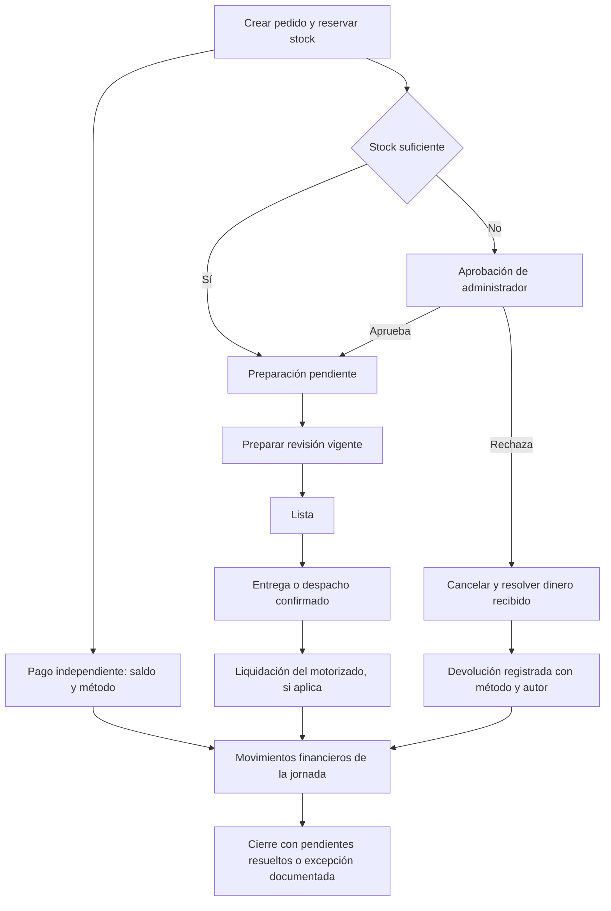

# Auditoría de procesos y recuperación de restaurant-pos

Fecha: 6 de octubre de 2026, America/Guayaquil. Revisión: `de69983`. Alcance: checkout local, sin cambios funcionales, sin consultas ni escrituras en la base real y sin enviar comandas a la impresora.

## Diagnóstico

El sistema tiene una base útil: transacciones para crear y modificar órdenes, descuentos de stock condicionados, numeración diaria única, sesiones de servidor, cobros con claves de idempotencia y bloqueo de caja durante movimientos financieros. Sin embargo, todavía hay caminos que permiten perder pedidos de cocina, alterar inventario o usuarios sin autorización y cambiar cifras financieras sin una corrección trazable.

Se identificaron **24 hallazgos: 1 crítico (P0), 15 de prioridad alta (P1) y 8 de prioridad media (P2)**. Incluyen defectos de implementación y carencias de recuperación. No todos son errores que ocurran en cada venta: algunos requieren concurrencia, datos incorrectos, operaciones de días anteriores o una caída de red.

**Prioridad inmediata:** cerrar las APIs administrativas sin autorización; separar el estado del pago del estado de preparación; asegurar anulaciones, devoluciones y cierre financiero; unificar cortesías y stock con las protecciones del flujo normal.

Pasar las pruebas actuales no equivale a estar libre de errores. Se ejecutaron las 17 suites del proyecto, las del agente Node, los 10 tests del agente Python, TypeScript y ESLint: todos pasaron. Además, **19 escenarios aislados reprodujeron defectos o configuraciones peligrosas**. Las reproducciones ejecutan handlers o funciones reales con dependencias en memoria; no sustituyen pruebas concurrentes con PostgreSQL ni verificación física de tickets.

## Cobertura y método

- Se inventariaron y revisaron los **34 archivos de rutas y sus 42 handlers**, los cuatro paneles por rol, creación/edición/cobro/cortesías, apertura/retiro/cierre, reportes, sesiones, esquema y migraciones, almacenamiento de comprobantes, SSE y ambos agentes de impresión.
- Se trazaron las acciones desde la pantalla hasta la escritura, la respuesta y las lecturas posteriores, prestando atención a stock, total, monto pagado, estado operativo, historial y comanda.
- Se reutilizó el grafo existente, de 1.085 nodos y 2.121 relaciones, como mapa. Su manifest no contiene cuatro rutas actuales: caja, anulación de orden, subida y consulta de comprobantes. Por ello las conclusiones se basan en el código actual, también para esas rutas. No se reconstruyó el grafo ni se usó extracción externa.
- No se instaló software, no se ejecutaron migraciones, seed ni reset, no se inició sesión en producción y no se cambiaron reglas del negocio.
- Infraestructura, datos históricos reales, dispositivos, comportamiento de varias instancias y operación real de empleados quedan como validaciones pendientes, indicadas expresamente más adelante.

## Flujos actuales por rol

| Rol | Secuencia actual | Protecciones comprobadas | Riesgos y mejoras prioritarias |
| --- | --- | --- | --- |
| Mesero | Login → apertura de caja → carrito → validación de stock → creación → cocina → lista de órdenes → cobro → retiro | Cookie de servidor; creador sale de sesión; precio sale del producto; descuento condicionado; retiro con idempotencia | Identidad sin clave; reintento de creación duplica; lista depende del nombre; no hay relevo; pedidos listos requieren actualizar manualmente; cobro y estado operativo se mezclan |
| Digital | Login → para llevar/domicilio → modalidad prevista → transferencia confirmada o efectivo → stock/aprobación → cocina → cobro/recogida | Autoría de sesión; requisitos por tipo; transferencia confirmada crea pago; cobro por saldo | Pedido pagado no implica despachado; falta dirección y entrega estructurada; confirmación inicial no captura comprobante; misma fragilidad de reintento, listados y corrección |
| Cocina | Login → pendientes/en preparación de hoy → aviso SSE o polling → ver comanda → marcar lista | Acceso por sesión/rol; polling de respaldo de 30 segundos; anuladas no aparecen | QR puede sacar pedidos pendientes; no se confirma revisión preparada; cortesía en una lista no vuelve al monitor; edición en curso puede ser marcada lista con una tarjeta vieja; error HTTP puede romper la lista |
| Administrador | Login → cuadre/stock bajo → aprobación/rechazo → cortesías → usuarios/productos → anulación → cierre → reportes | Cuadre exige rol; apertura única diaria; cierre y cobro usan candado de caja; razones en anulación; no borrado de órdenes | APIs administrativas parcialmente abiertas; cierre permite impagos totales; anulaciones alteran reportes cerrados; reembolso incompleto; no hay corrección guiada de fondo/pago; impresiones fallidas sin panel de recuperación |
| Motorizado — participante externo | Comanda con modalidad/envío → retiro del pedido → liquidación en efectivo | Fórmula de liquidación y pruebas de casos efectivos/transferencia/mixtos | No existe rol ni registro de asignación, entrega, entrega de dinero o liquidación real. El cuadre presume movimientos a partir del cobro |

Hay cuatro roles del sistema: `admin`, `mesero`, `cocina` y `digital`. “Motorizado” describe un participante del proceso; no se debe asumir que existe un panel suyo. Fuente: [types/usuario.ts:3](/Users/mauriciopesantezg/restaurant-pos/types/usuario.ts:3).

### Creación, preparación y pago

| Rama | Estado inicial y efecto | Continuación actual |
| --- | --- | --- |
| Local con stock | `pendiente`; descuenta stock; número diario; historial; comanda | Cocina marca lista; cobro interno exige lista/entregada/cobrada; QR permite cobrar antes |
| Para llevar con stock | Igual; nombre obligatorio; recargo por combos | Se puede cobrar antes de preparar; cobro interno anticipado conserva pendiente/en preparación |
| Domicilio efectivo | Teléfono, envío y modalidad; no nace pagado | El motorizado conserva el envío; el cobro contable registra importe bruto y cuadre calcula neto |
| Domicilio transferencia | Confirmación obligatoria; nace pagado; caja abierta obligatoria | Pago registrado incluso si requiere aprobación de stock; preparación y entrega siguen pendientes |
| Falta de stock + solicitar aprobación | `pendiente_aprobacion_stock`; no descuenta stock ni imprime | Admin aprueba con descuento que puede quedar negativo, o rechaza y cancela |
| Falta de stock sin solicitar aprobación | Intenta creación normal; descuento condicionado falla y revierte | Devuelve 409; no hay creación forzada desde esta rama |
| Producto repetido en varias líneas | La prevalidación compara cada línea con el mismo stock | El descuento final sí impide sobreventa, pero la aprobación puede no solicitarse para el total agregado |
| Orden pagada que aumenta | Edición permite aumentar; vuelve a tener saldo; si agrega preparación vuelve a cocina | Cobra solo el saldo; no hay reducción/devolución parcial |

Una aprobación sin stock puede producir stock negativo **por decisión explícita del negocio**. Eso es distinto del stock negativo involuntario de una cortesía: debe mostrarse como deuda de inventario y exigir motivo, sin impedir la excepción autorizada.

### Separación propuesta de responsabilidades



El diagrama es una propuesta. Un pedido debe poder estar **pagado y pendiente de preparación**, o **entregado y con deuda**, sin perder ninguna de esas dos realidades.

## Hallazgos y qué hacer

### A01 · P0 · Las APIs de usuarios, productos, stock y reportes no hacen cumplir los permisos

**Ubicación:** [app/api/usuarios/route.ts:50](/Users/mauriciopesantezg/restaurant-pos/app/api/usuarios/route.ts:50), [app/api/usuarios/[id]/route.ts:41](/Users/mauriciopesantezg/restaurant-pos/app/api/usuarios/[id]/route.ts:41), [app/api/productos/route.ts:21](/Users/mauriciopesantezg/restaurant-pos/app/api/productos/route.ts:21), [app/api/productos/[id]/route.ts:5](/Users/mauriciopesantezg/restaurant-pos/app/api/productos/[id]/route.ts:5), [app/api/stock/actualizar/route.ts:6](/Users/mauriciopesantezg/restaurant-pos/app/api/stock/actualizar/route.ts:6), [app/api/admin/reportes/modificaciones/route.ts:19](/Users/mauriciopesantezg/restaurant-pos/app/api/admin/reportes/modificaciones/route.ts:19), [app/api/admin/reportes/cortesias/route.ts:13](/Users/mauriciopesantezg/restaurant-pos/app/api/admin/reportes/cortesias/route.ts:13).

**Impacto:** ocultar un panel mediante `useAuth` no protege su API. Los handlers de escritura no consultan sesión ni rol. Es posible crear un administrador, quitar una contraseña, cambiar precios o stock sin autenticarse. Los reportes tampoco exigen admin. No se encontró middleware/proxy que compense esto dentro del repositorio.

**Evidencia:** handlers reales, con sesión simulada ausente, devolvieron 201 al crear admin/producto y 200 al quitar contraseña y modificar stock; no llamaron a autenticación. No se enviaron estas solicitudes a un servidor real. La exposición pública efectiva depende también de controles externos que no se inspeccionaron.

**Qué hacer:** autenticar y autorizar en cada handler; proteger creación/edición de usuarios, productos y stock, y consulta administrativa de reportes. Conservar únicamente los datos mínimos públicos necesarios para el selector de login. Definir también quién puede consultar existencias.

**Aceptación:** anónimo → 401, rol equivocado → 403, admin válido → éxito en cada escritura. Cambiar localStorage no debe otorgar acceso. Probar también las rutas por ID y `vista=admin`.

### A02 · P1 · Cobrar por QR retira de cocina una orden que todavía no se preparó

**Ubicación:** [lib/order-payment.ts:172](/Users/mauriciopesantezg/restaurant-pos/lib/order-payment.ts:172), [lib/order-payment.ts:253](/Users/mauriciopesantezg/restaurant-pos/lib/order-payment.ts:253), [app/cocina/page.tsx:106](/Users/mauriciopesantezg/restaurant-pos/app/cocina/page.tsx:106).

**Secuencia:** crear pendiente → cobrar por QR → `estado = cobrada` sin haber preparado → monitor solo consulta pendiente/en preparación → pedido desaparece.

**Impacto:** pago exitoso puede ocultar trabajo pendiente. El comportamiento está descrito en `docs/COBROS_QR.md`, pero sigue siendo un riesgo de diseño para la operación solicitada. El cobro interno anticipado de para llevar/domicilio sí conserva pendiente/en preparación; no tiene este mismo efecto.

**Evidencia:** la función real de cobro, con persistencia simulada, dejó `estado = cobrada`; el filtro real del monitor lo excluye.

**Qué hacer:** mantener el estado operativo al pagar y representar el pago con saldo/cobrada. Terminar preparación y entrega mediante acciones separadas. Ajustar consumidores, compatibilidad de estados históricos y métricas.

**Aceptación:** pendiente + pago QR → sigue visible en cocina como pendiente y pagada; marcar lista/entregar después funciona sin volver a cobrar.

### A03 · P1 · Los cambios de estado pueden saltar aprobaciones y confirmar una revisión vieja

**Ubicación:** [app/api/ordenes/[id]/route.ts:5](/Users/mauriciopesantezg/restaurant-pos/app/api/ordenes/[id]/route.ts:5), [app/api/ordenes/[id]/route.ts:31](/Users/mauriciopesantezg/restaurant-pos/app/api/ordenes/[id]/route.ts:31), [app/api/ordenes/[id]/route.ts:51](/Users/mauriciopesantezg/restaurant-pos/app/api/ordenes/[id]/route.ts:51), [components/cocina/OrdenCard.tsx:313](/Users/mauriciopesantezg/restaurant-pos/components/cocina/OrdenCard.tsx:313).

**Impacto:** se valida que el destino sea conocido, pero no que la transición sea válida desde el estado actual. Cocina/admin pueden pasar una pendiente de aprobación a preparación sin descontar stock, o reactivar una cancelada. No se registra historial de esta transición. Tampoco se exige revisión: cocina puede marcar lista una orden después de que otra persona añadió comida, usando una tarjeta anterior.

**Evidencia:** el handler aceptó pendiente_aprobacion_stock → en_preparacion y cancelada → pendiente. Las ventanas de concurrencia se deducen de la lectura y posterior escritura por ID; no se ejecutaron contra PostgreSQL.

**Qué hacer:** definir transiciones por rol y estado; usar condición por estado/revisión/anulada en la escritura, con 409 si cambió; registrar autor, hora y revisión preparada. Mantener explícitamente pendiente → lista si esa sigue siendo la acción elegida en cocina, o introducir la acción “empezar preparación”.

**Aceptación:** no se puede evadir aprobación/rechazo; confirmar una tarjeta vieja no marca preparada la comida nueva; cada transición queda auditada.

### A04 · P1 · El ajuste de stock pierde cambios concurrentes y la devolución de consumo es ambigua

**Ubicación:** [app/api/stock/actualizar/route.ts:43](/Users/mauriciopesantezg/restaurant-pos/app/api/stock/actualizar/route.ts:43), [app/api/stock/actualizar/route.ts:59](/Users/mauriciopesantezg/restaurant-pos/app/api/stock/actualizar/route.ts:59), [app/api/ordenes/[id]/items/route.ts:270](/Users/mauriciopesantezg/restaurant-pos/app/api/ordenes/[id]/items/route.ts:270), [app/api/ordenes/[id]/items/route.ts:433](/Users/mauriciopesantezg/restaurant-pos/app/api/ordenes/[id]/items/route.ts:433).

**Secuencia:** dos ajustes leen 10 y agregan 5; ambos escriben 15. Un ajuste que coincidió con una venta también puede sobrescribir el descuento. Además, quitar/reducir un item en preparación devuelve siempre el stock, aunque ya se consumió o desperdició.

**Evidencia:** dos invocaciones concurrentes simuladas de “agregar 5” terminaron en 15, en lugar de 20. En producción la pérdida requiere el intercalado descrito. La reposición automática se confirmó leyendo el handler.

**Qué hacer:** incremento/decremento atómico con condiciones; para “establecer”, revisión y confirmación de conteo. Registrar movimientos con motivo, autor, pedido y saldo. Al cancelar comida en preparación, diferenciar reserva liberada de consumo/merma; no crear existencia vendible a partir de desperdicio.

**Aceptación:** ajuste + venta conserva ambas operaciones; reintento del ajuste no duplica; una merma no aumenta stock. Aprobar sin stock debe seguir siendo una excepción registrada.

### A05 · P1 · La cortesía evita las protecciones del flujo de edición

**Ubicación:** [app/api/ordenes/[id]/cortesia/route.ts:63](/Users/mauriciopesantezg/restaurant-pos/app/api/ordenes/[id]/cortesia/route.ts:63), [app/api/ordenes/[id]/cortesia/route.ts:72](/Users/mauriciopesantezg/restaurant-pos/app/api/ordenes/[id]/cortesia/route.ts:72), [app/api/ordenes/[id]/cortesia/route.ts:84](/Users/mauriciopesantezg/restaurant-pos/app/api/ordenes/[id]/cortesia/route.ts:84), [app/api/ordenes/[id]/items/route.ts:517](/Users/mauriciopesantezg/restaurant-pos/app/api/ordenes/[id]/items/route.ts:517).

**Impacto:** la cortesía verifica stock fuera de la transacción y luego descuenta sin condición. Dos solicitudes pueden vender la misma última unidad. No incrementa revisión, no encola modificación y no cambia lista/entregada a preparación; una cortesía para un pedido listo puede quedar fuera del monitor. Un combo tampoco exige picante. El recargo de envases no se recalcula al aplicar la cortesía, pero sí en una edición posterior, pudiendo cambiar el total por una acción distinta.

**Evidencia:** dos cortesías concurrentes simuladas con stock 1 dejaron -1; la orden quedó lista, revisión 0, sin picante ni recargo. Se emite SSE, pero eso no hace que una lista vuelva al filtro de pendientes de cocina.

**Qué hacer:** compartir las invariantes de edición: descuento condicionado, revisión, validación de picante, historial, comanda delta, retorno a cocina y protección frente a anulación/cobro concurrente. Definir expresamente si los recipientes de una cortesía también son gratis y aplicar esa regla en todos los recálculos.

**Aceptación:** dos cortesías para la última unidad no generan stock negativo accidental; combo tiene picante; cortesía nueva queda visible en cocina; costo de envases es consistente antes y después de editar.

### A06 · P1 · Anular una orden no ofrece una devolución financiera verificable

**Ubicación:** [app/api/ordenes/[id]/anular/route.ts:124](/Users/mauriciopesantezg/restaurant-pos/app/api/ordenes/[id]/anular/route.ts:124), [types/cuadre.ts:115](/Users/mauriciopesantezg/restaurant-pos/types/cuadre.ts:115), [types/cuadre.ts:217](/Users/mauriciopesantezg/restaurant-pos/types/cuadre.ts:217).

**Impacto:** se convierten pagos a REEMBOLSO_PENDIENTE solo si la lectura previa tenía `cobrada = true`. Una orden que aumentó después de pagarse tiene dinero recibido y `cobrada = false`, por lo que sus pagos quedan CONFIRMADOS al anular. También puede ocurrir por una carrera con cobro. A la vez, el resumen excluye completamente las anuladas: su devolución pendiente desaparece de la cifra de reembolsos. El texto de pantalla asume que se devuelve el dinero, pero no registra cuándo, cuánto ni por qué método se devolvió.

**Evidencia:** anulación de una orden simulada con total 15/pagado 10 no actualizó pagos. La función de cuadre devolvió reembolso pendiente 0 para una anulada con un pago pendiente de devolver de 10.

**Qué hacer:** decidir sobre los pagos existentes dentro de la transacción y conservar el dinero como movimiento. Crear devolución con importe, método, autor, fecha, confirmación e idempotencia. Separar cancelación de venta, deuda con cliente y salida real de caja/banco. Manejar también devoluciones de domicilios cuyo envío ya fue liquidado.

**Aceptación:** anulación antes/después de cobro y con saldo reabierto conserva toda la deuda; devolverla una vez produce un movimiento y extingue solo ese importe; reintento no devuelve dos veces.

### A07 · P1 · Rechazar una orden pagada por falta de stock todavía suma venta y envío

**Ubicación:** [app/api/ordenes/aprobacion/rechazar/route.ts:62](/Users/mauriciopesantezg/restaurant-pos/app/api/ordenes/aprobacion/rechazar/route.ts:62), [app/api/ordenes/aprobacion/rechazar/route.ts:91](/Users/mauriciopesantezg/restaurant-pos/app/api/ordenes/aprobacion/rechazar/route.ts:91), [types/cuadre.ts:115](/Users/mauriciopesantezg/restaurant-pos/types/cuadre.ts:115), [lib/cuadre-date.ts:15](/Users/mauriciopesantezg/restaurant-pos/lib/cuadre-date.ts:15).

**Secuencia:** domicilio por transferencia se paga al crear → falta stock → admin rechaza → cancelada y REEMBOLSO_PENDIENTE → el resumen, que no distingue cancelada y no excluye ese estado de pago de los montos, sigue contando venta y liquidación del envío.

**Evidencia:** total 23/envío 3 rechazado produjo venta cobrada 20 y efectivo -3, además de devolución pendiente 23. Conservar el depósito recibido es correcto; reconocer venta y una entrega de efectivo al motorizado que no ocurrió es el problema.

**Qué hacer:** excluir venta cancelada sin borrar el ingreso real; mostrar el depósito y la obligación de devolución por separado. Liquidar envío únicamente cuando exista una liquidación registrada, o una excepción explícita si el motorizado ya prestó el servicio.

**Aceptación:** rechazo antes de preparar no crea venta ni pago ficticio de envío; dinero recibido y devolución permanecen visibles.

### A08 · P1 · El cierre no congela los movimientos y el envío puede cambiar de jornada

**Ubicación:** [app/api/caja/route.ts:218](/Users/mauriciopesantezg/restaurant-pos/app/api/caja/route.ts:218), [app/api/ordenes/[id]/anular/route.ts:80](/Users/mauriciopesantezg/restaurant-pos/app/api/ordenes/[id]/anular/route.ts:80), [app/api/retiros/[id]/anular/route.ts:51](/Users/mauriciopesantezg/restaurant-pos/app/api/retiros/[id]/anular/route.ts:51), [app/api/ordenes/[id]/items/route.ts:133](/Users/mauriciopesantezg/restaurant-pos/app/api/ordenes/[id]/items/route.ts:133), [lib/cuadre-server.ts:88](/Users/mauriciopesantezg/restaurant-pos/lib/cuadre-server.ts:88), [lib/cuadre-date.ts:19](/Users/mauriciopesantezg/restaurant-pos/lib/cuadre-date.ts:19), [types/cuadre.ts:169](/Users/mauriciopesantezg/restaurant-pos/types/cuadre.ts:169).

**Impacto:** cobros/retiros nuevos usan candado de caja, pero anulaciones de órdenes/retiros, rechazo y edición no respetan el cierre financiero de la fecha afectada. El esperado congelado queda guardado, mientras el reporte se reconstruye con datos que todavía cambian. Una orden cerrada puede crecer al día siguiente y mover su condición “cobrada en fecha” al último pago, trasladando la liquidación del envío entre días.

**Evidencia:** domicilio transferencia 23/envío 3: el reporte inicial tiene efectivo -3. Tras aumentar 5 y cobrarlo en efectivo al día siguiente, recalcular día 1 da efectivo 0 y día 2 da +2, aunque el movimiento adicional real fue +5 y el cierre previo conservaba -3. Este escenario es alcanzable mediante edición de una orden cobrada, sin guardia de jornada.

**Otro efecto de interfaz:** los modales internos de mesero/digital vuelven a restar envío al saldo de un domicilio reabierto; el cliente QR distingue `esPrimerPago`, pero los textos generales todavía hablan de entregar/conservar envío de nuevo. Fuentes: [app/mesero/page.tsx:435](/Users/mauriciopesantezg/restaurant-pos/app/mesero/page.tsx:435), [app/digital/page.tsx:426](/Users/mauriciopesantezg/restaurant-pos/app/digital/page.tsx:426), [components/cobros/CobrarOrdenClient.tsx:106](/Users/mauriciopesantezg/restaurant-pos/components/cobros/CobrarOrdenClient.tsx:106), [components/cobros/CobrarOrdenClient.tsx:367](/Users/mauriciopesantezg/restaurant-pos/components/cobros/CobrarOrdenClient.tsx:367).

**Qué hacer:** asociar movimientos a jornada; bloquear mutación retroactiva o registrar ajustes compensatorios en una jornada abierta. Registrar liquidación de envío como hecho independiente, con ID y fecha. Compartir presentación de saldo y envío ya liquidado.

**Aceptación:** una corrección mañana no reescribe ayer; recaudar saldo adicional no vuelve a descontar/entregar envío; anular simultáneamente con cierre produce una decisión coherente y trazable.

### A09 · P1 · Se puede cerrar caja con órdenes totalmente impagas y crear más después

**Ubicación:** [app/api/caja/route.ts:201](/Users/mauriciopesantezg/restaurant-pos/app/api/caja/route.ts:201), [app/api/ordenes/route.ts:330](/Users/mauriciopesantezg/restaurant-pos/app/api/ordenes/route.ts:330), [app/api/ordenes/route.ts:86](/Users/mauriciopesantezg/restaurant-pos/app/api/ordenes/route.ts:86).

**Impacto:** el cierre bloquea únicamente órdenes con algún pago y saldo pendiente. Las que no recibieron nada no bloquean. Crear una orden sin pago inicial tampoco exige caja abierta: puede crearse después del cierre y luego no cobrarse ese día. Al cambiar de fecha, la API operativa de mesero/digital/cocina filtra al día actual y el pedido anterior desaparece de sus listas.

**Evidencia:** cierre real con cuadre simulado de una orden total 10/pagado 0 devolvió 200 y caja cerrada.

**Qué hacer:** cierre con checklist de todos los pedidos operativos, saldos, aprobaciones y entregas; impedir nuevas ventas después del cierre o abrir una continuación de jornada explícita. Si se permite crédito, permitirlo como decisión con responsable/vencimiento, y mantenerlo visible entre días.

**Aceptación:** no desaparece una deuda por llegar medianoche; cierre con impagos exige resolverlos o documentar crédito/excepción; orden posterior al cierre no entra silenciosamente en una jornada bloqueada.

### A10 · P1 · Reintentar una creación puede duplicar pedido, stock y transferencia

**Ubicación:** [app/api/ordenes/route.ts:335](/Users/mauriciopesantezg/restaurant-pos/app/api/ordenes/route.ts:335), [components/mesero/CrearOrden.tsx:305](/Users/mauriciopesantezg/restaurant-pos/components/mesero/CrearOrden.tsx:305).

**Secuencia:** servidor guarda la orden → se pierde respuesta o hay fallo posterior al commit → usuario vuelve a enviar → segunda orden con otro ID/número. Una transferencia al crear puede registrarse dos veces como dos ventas distintas.

**Evidencia:** repetir dos veces el mismo body, incluso con un `clientRequestId`, creó dos órdenes en el handler simulado. Ese campo no se utiliza en el flujo actual. Las claves de impresión solo deduplican por orden, no por la intención original de creación.

**Qué hacer:** intención de creación con identificador estable en cliente y restricción única en servidor; vincular respuesta a esa intención. Ante respuesta incierta, consultar estado antes de crear otra. Aplicar también a cortesías y ajustes que agregan unidades.

**Aceptación:** doble clic, timeout y reintento crean una orden, un descuento de stock, un cobro automático y un trabajo inicial.

### A11 · P1 · Las configuraciones permiten impresión doble o caminos sin comanda

**Ubicación:** [lib/print-config.ts:4](/Users/mauriciopesantezg/restaurant-pos/lib/print-config.ts:4), [app/api/ordenes/route.ts:489](/Users/mauriciopesantezg/restaurant-pos/app/api/ordenes/route.ts:489), [app/api/ordenes/route.ts:507](/Users/mauriciopesantezg/restaurant-pos/app/api/ordenes/route.ts:507), [app/api/ordenes/aprobacion/aprobar/route.ts:188](/Users/mauriciopesantezg/restaurant-pos/app/api/ordenes/aprobacion/aprobar/route.ts:188), [app/api/ordenes/[id]/items/route.ts:613](/Users/mauriciopesantezg/restaurant-pos/app/api/ordenes/[id]/items/route.ts:613).

**Impacto:** activar la cola no desactiva impresión directa, cuyo valor por defecto es true. Una creación puede quedar en cola y también imprimirse directamente. Aprobación y modificación utilizan solo cola; en una instalación que depende de impresión directa, esos caminos no imprimen. El corte de fecha también necesita tratamiento explícito para órdenes anteriores.

**Evidencia:** `queue=true` y configuración directa ausente resultan ambos activos. La ocurrencia real depende de las variables y del agente desplegados, que no se inspeccionaron.

**Qué hacer:** escoger un modo único y validar configuración al arrancar/desplegar; preferir la cola para todas las comandas. Exponer estado del modo y una alarma cuando no haya mecanismo. Tratar órdenes anteriores al corte mediante reimpresión controlada.

**Aceptación:** cada creación, aprobación, edición y cortesía produce exactamente un trabajo esperado; configuración doble/incompleta se rechaza o alerta antes de operar.

### A12 · P1 · Confirmación incierta de impresión, orden de revisiones y anulaciones necesitan intervención

**Ubicación:** [print-agent/src/worker.ts:112](/Users/mauriciopesantezg/restaurant-pos/print-agent/src/worker.ts:112), [print-agent/src/worker.ts:126](/Users/mauriciopesantezg/restaurant-pos/print-agent/src/worker.ts:126), [print-agent/src/printer.ts:385](/Users/mauriciopesantezg/restaurant-pos/print-agent/src/printer.ts:385), [lib/print-agent-jobs.ts:46](/Users/mauriciopesantezg/restaurant-pos/lib/print-agent-jobs.ts:46), [lib/print-agent-jobs.ts:74](/Users/mauriciopesantezg/restaurant-pos/lib/print-agent-jobs.ts:74), [app/api/ordenes/[id]/anular/route.ts:10](/Users/mauriciopesantezg/restaurant-pos/app/api/ordenes/[id]/anular/route.ts:10).

**Impacto:** enviar bytes por TCP no prueba salida física. Si la comanda salió pero el ACK a la API falla, el lease vence y el claim la mueve a RETRY: otro intento puede imprimirla otra vez. No hay comprobación persistente local del ticket ya enviado. El claim tampoco exige terminar el trabajo inicial/revisión anterior antes de imprimir una modificación; un reintento diferido puede permitir que la modificación salga primero. Anulación descarta pendientes/retry/review, pero no detiene PROCESSING; tras vencer puede volver a RETRY y claim no consulta `orden.anulada`.

**Evidencia:** comportamiento confirmado en el código de los dos agentes y la cola. No se provocaron cortes en una impresora real, ni se probó el intercalado de workers con PostgreSQL. La deduplicación de filas no garantiza una sola salida física.

**Qué hacer:** distinguir “no enviado” de “posiblemente enviado”; llevar el segundo a revisión humana y persistir intentos locales antes de volver a imprimir. Ordenar trabajos por orden/revisión/dependencia. Revalidar anulación al reclamar; enviar aviso de cancelación cuando ya pudo salir el ticket. No prometer exactamente una impresión con TCP sin confirmación del dispositivo.

**Aceptación:** pérdida de ACK no genera reimpresión automática ciega; modificación no precede a inicial; orden anulada no vuelve a reclamar una comanda vieja.

### A13 · P2 · No hay una recuperación operativa de impresiones fallidas y la pantalla anuncia éxito antes de imprimir

**Ubicación:** [lib/print-jobs.ts:6](/Users/mauriciopesantezg/restaurant-pos/lib/print-jobs.ts:6), [lib/print-agent-jobs.ts:60](/Users/mauriciopesantezg/restaurant-pos/lib/print-agent-jobs.ts:60), [components/mesero/CrearOrden.tsx:336](/Users/mauriciopesantezg/restaurant-pos/components/mesero/CrearOrden.tsx:336), [app/api/ordenes/route.ts:524](/Users/mauriciopesantezg/restaurant-pos/app/api/ordenes/route.ts:524), [PRINTING_IMPLEMENTATION_PLAN.md:151](/Users/mauriciopesantezg/restaurant-pos/PRINTING_IMPLEMENTATION_PLAN.md:151).

**Impacto:** la cola caduca normalmente a los cinco minutos y deja NEEDS_REVIEW; también existe FAILED y heartbeat. No se encontró panel/API administrativo para listar, resolver o reimprimir estos trabajos; la ruta de reprint aparece como plan, no implementación. Encolado se devuelve como `impresion.success = true` y la pantalla anuncia “enviada e impresa”, aunque el agente esté apagado.

**Qué hacer:** panel de impresión con estado de agente, impresora, trabajos atrasados y última causa; acciones “confirmar que salió”, “reimprimir con motivo”, “descartar”. Mostrar “guardada/en cola” hasta confirmación y diferenciar esa confirmación de garantía física.

**Aceptación:** tras apagón prolongado un empleado identifica pendientes y resuelve cada ticket sin acceder a SQL, reiniciar toda la aplicación o recrear pedidos.

### A14 · P2 · Listas por nombre, relevos y pedidos pagados limitan la operación

**Ubicación:** [app/api/ordenes/route.ts:66](/Users/mauriciopesantezg/restaurant-pos/app/api/ordenes/route.ts:66), [app/mesero/page.tsx:82](/Users/mauriciopesantezg/restaurant-pos/app/mesero/page.tsx:82), [app/mesero/page.tsx:109](/Users/mauriciopesantezg/restaurant-pos/app/mesero/page.tsx:109), [app/digital/page.tsx:98](/Users/mauriciopesantezg/restaurant-pos/app/digital/page.tsx:98), [lib/order-payment.ts:42](/Users/mauriciopesantezg/restaurant-pos/lib/order-payment.ts:42).

**Impacto:** servidor reconoce creador por ID, pero cliente vuelve a filtrar `orden.mesero === usuario.nombre`. Renombrar al empleado oculta sus pedidos existentes. Aunque cualquier cobrador puede cobrar otra orden por enlace, su lista no permite encontrarla para un relevo. Se excluye estado cobrada: el API permite crecer una orden pagada, pero mesero/digital no pueden abrirla desde su lista habitual. Además, el mesero solo habilita cobro local en lista, cuando el API permite entregada.

**Qué hacer:** basar pertenencia y filtros en ID; separar vista “mis pedidos” de una bandeja de cobros compartida con permisos. Mantener pedidos pagados sin entregar y ofrecer ampliación permitida. Definir asignación/relevo con historial.

**Aceptación:** cambiar nombre no cambia visibilidad; un relevo encuentra la cuenta sin necesitar el teléfono de quien la creó; una entregada impaga se puede cobrar; pagada no implica desaparecer de despacho.

### A15 · P1 · Las credenciales opcionales no permiten atribuir con confianza quién operó

**Ubicación:** [app/api/auth/login/route.ts:20](/Users/mauriciopesantezg/restaurant-pos/app/api/auth/login/route.ts:20), [lib/admin-validaciones.ts:168](/Users/mauriciopesantezg/restaurant-pos/lib/admin-validaciones.ts:168), [lib/session.ts:10](/Users/mauriciopesantezg/restaurant-pos/lib/session.ts:10), [app/api/usuarios/[id]/route.ts:41](/Users/mauriciopesantezg/restaurant-pos/app/api/usuarios/[id]/route.ts:41), [components/admin/FormularioUsuario.tsx:98](/Users/mauriciopesantezg/restaurant-pos/components/admin/FormularioUsuario.tsx:98).

**Impacto:** una persona sin contraseña se autentica solo por seleccionar su ID. Se permite también un admin sin contraseña. Las claves existentes se almacenan y comparan en texto plano. No se encontró limitación de intentos en el login dentro del repositorio ni revocación de sesiones al cambiar contraseña. Las restricciones de no desactivarse/no cambiar rol propio están en UI, sin equivalente en API; falta proteger al último admin.

**Qué hacer:** credencial individual para cada operador y obligatoria para admin; migración compatible a hash; límite de intentos; revocar sesiones al restablecer clave. Aplicar en servidor la protección del último administrador. Si se mantiene un modo compartido de dispositivo, describir su autoría como dispositivo y exigir identificación para movimientos sensibles.

**Aceptación:** conocer un ID no basta para retirar/cobrar; cambio de clave revoca sesiones anteriores; nadie elimina por error el último acceso administrativo; mantener compatibilidad de acceso durante migración.

### A16 · P1 · Los tipos TypeScript no validan las solicitudes y un envío textual cambia el total

**Ubicación:** [app/api/ordenes/route.ts:116](/Users/mauriciopesantezg/restaurant-pos/app/api/ordenes/route.ts:116), [app/api/ordenes/route.ts:149](/Users/mauriciopesantezg/restaurant-pos/app/api/ordenes/route.ts:149), [app/api/ordenes/route.ts:315](/Users/mauriciopesantezg/restaurant-pos/app/api/ordenes/route.ts:315), [app/api/stock/actualizar/route.ts:9](/Users/mauriciopesantezg/restaurant-pos/app/api/stock/actualizar/route.ts:9).

**Impacto:** se aceptan tipos de orden desconocidos; mesa no se valida contra mesas existentes ni exige entero positivo; teléfono solo exige no vacío; cantidades no tienen límite razonable; varios cuerpos nulos/campos de tipo incorrecto terminan en 500. `costoEnvio` no exige un número finito ni centavos exactos. Con valor string se concatena al subtotal.

**Evidencia:** tipo robot persistió en el handler. Combo 11 + envase 1,25 + envío string "3" calculó string "12.253", en lugar de 15,25. Con un campo Decimal(10,2), la persistencia puede terminar en 12,25. La prueba no escribió ese valor en PostgreSQL.

**Qué hacer:** schemas de entrada sobre `unknown`, validación explícita de enums, números/precisión/límites, strings y longitud, existencia de mesa y requisitos por tipo. Agregar cantidades por producto para validar stock aunque haya distintas variantes. No convertir errores de datos en errores genéricos del servidor.

**Aceptación:** strings/arrays/objetos/nulos donde se esperan números no producen mutaciones; mesa inexistente y tipo desconocido devuelven 400; múltiples variantes calculan demanda agregada.

### A17 · P1 · El cobro acepta fracciones de centavo y puede desalinear monto pagado y pagos

**Ubicación:** [lib/order-payment-validaciones.ts:38](/Users/mauriciopesantezg/restaurant-pos/lib/order-payment-validaciones.ts:38), [types/cobro.ts:19](/Users/mauriciopesantezg/restaurant-pos/types/cobro.ts:19), [lib/order-payment.ts:169](/Users/mauriciopesantezg/restaurant-pos/lib/order-payment.ts:169), [lib/order-payment.ts:264](/Users/mauriciopesantezg/restaurant-pos/lib/order-payment.ts:264), [lib/admin-validaciones.ts:69](/Users/mauriciopesantezg/restaurant-pos/lib/admin-validaciones.ts:69).

**Impacto:** validación suma centavos redondeados, pero persiste `parte.monto` original en Decimal(10,2). Las dos conversiones no siempre coinciden. La validación de precio también comprueba positivo antes de redondear: un precio positivo muy pequeño puede acabar en cero.

**Evidencia:** saldo 9,99 con efectivo 1,005 y transferencia 8,99 se acepta por redondeo de Number; monto materializado queda 9,99, pero el redondeo decimal a dos posiciones suma 10,00. La prueba usa Prisma.Decimal para ilustrar el redondeo; el comportamiento efectivo debe verificarse también en PostgreSQL aislado.

**Qué hacer:** rechazar más de dos decimales, tipos/coerciones extrañas y valores fuera de límites; usar representación canónica en centavos o Decimal exacto en validación y escritura. Verificar precio después de normalizar. Comprobar `montoPagado = suma de cobros vigentes` mediante pruebas y conciliación.

**Aceptación:** 1,005 se rechaza; montos aceptados conservan la igualdad de suma/orden al persistirse; no se puede crear producto de precio cero por redondeo accidental.

### A18 · P2 · Los tiempos ignoran las categorías del menú actual y usan una fecha que cambia por otros motivos

**Ubicación:** [app/api/ordenes/route.ts:288](/Users/mauriciopesantezg/restaurant-pos/app/api/ordenes/route.ts:288), [app/api/ordenes/[id]/items/route.ts:547](/Users/mauriciopesantezg/restaurant-pos/app/api/ordenes/[id]/items/route.ts:547), [prisma/seed.ts:25](/Users/mauriciopesantezg/restaurant-pos/prisma/seed.ts:25), [components/cocina/OrdenCard.tsx:92](/Users/mauriciopesantezg/restaurant-pos/components/cocina/OrdenCard.tsx:92), [app/admin/page.tsx:311](/Users/mauriciopesantezg/restaurant-pos/app/admin/page.tsx:311).

**Impacto:** cálculo considera Platos Fuertes/Acompañamientos/Entradas, mientras el menú seed utiliza Combos/Extras/Bebidas. Un Combo con tiempo configurado 20 produce estimado 0; con estimado 0 nunca se activa el porcentaje de retraso. Para medir tiempo real admin usa `updatedAt`, que también cambia con pagos, ediciones y anulaciones, no la hora efectiva de preparación.

**Evidencia:** creación con Combo/tiempo 20 dio tiempoEstimado 0.

**Qué hacer:** política de preparación independiente del nombre libre de categoría, o categorías normalizadas con una regla explícita. Registrar empezóPreparación/lista/entregada y revisión; distinguir espera de aprobación y preparación extra posterior.

**Aceptación:** combos activan alarmas útiles; pagar tarde no cambia la duración de cocina; ampliación no se mide como si toda la comida nueva hubiera esperado desde la creación original.

### A19 · P2 · Reportes de modificaciones y cortesías no usan el mismo día ni la misma clasificación que el cuadre

**Ubicación:** [app/api/admin/reportes/modificaciones/route.ts:34](/Users/mauriciopesantezg/restaurant-pos/app/api/admin/reportes/modificaciones/route.ts:34), [app/api/admin/reportes/modificaciones/route.ts:56](/Users/mauriciopesantezg/restaurant-pos/app/api/admin/reportes/modificaciones/route.ts:56), [app/api/admin/reportes/modificaciones/route.ts:137](/Users/mauriciopesantezg/restaurant-pos/app/api/admin/reportes/modificaciones/route.ts:137), [app/api/admin/reportes/cortesias/route.ts:28](/Users/mauriciopesantezg/restaurant-pos/app/api/admin/reportes/cortesias/route.ts:28), [lib/fecha-ecuador.ts:15](/Users/mauriciopesantezg/restaurant-pos/lib/fecha-ecuador.ts:15).

**Impacto:** inicio YYYY-MM-DD se interpreta UTC, fin sin zona depende del servidor y gráfico agrupa por UTC. Eventos cercanos a medianoche cambian de día frente al cuadre Ecuador. “Modificaciones” excluye solo orden_creada y orden_completada: puede contar cobros, aprobaciones, rechazos y creación pendiente de stock, incluyendo su importe como aumento. Anular elimina retrospectivamente cortesías y modificaciones del reporte, incluso si la comida ya se regaló/consumió.

**Qué hacer:** rango Ecuador compartido, fin exclusivo y validación de fechas; lista positiva de acciones de edición; distinguir métricas operativas/auditoría de cifras de ventas vigentes. Preservar un reporte de eventos históricos, con marca de anulación.

**Aceptación:** un mismo evento cae en el mismo día en todos los paneles; cobrar no incrementa el contador de modificaciones de items; anular venta no borra evidencia de consumo ni decisiones.

### A20 · P2 · Varias pantallas convierten fallos en vacío, datos viejos o mensajes poco recuperables

**Ubicación:** [app/cocina/page.tsx:106](/Users/mauriciopesantezg/restaurant-pos/app/cocina/page.tsx:106), [app/cocina/page.tsx:229](/Users/mauriciopesantezg/restaurant-pos/app/cocina/page.tsx:229), [app/mesero/page.tsx:103](/Users/mauriciopesantezg/restaurant-pos/app/mesero/page.tsx:103), [components/mesero/CrearOrden.tsx:291](/Users/mauriciopesantezg/restaurant-pos/components/mesero/CrearOrden.tsx:291), [components/mesero/CrearOrden.tsx:354](/Users/mauriciopesantezg/restaurant-pos/components/mesero/CrearOrden.tsx:354), [lib/auth.ts:25](/Users/mauriciopesantezg/restaurant-pos/lib/auth.ts:25), [lib/auth.ts:34](/Users/mauriciopesantezg/restaurant-pos/lib/auth.ts:34), [lib/sse.ts:19](/Users/mauriciopesantezg/restaurant-pos/lib/sse.ts:19).

**Impacto:** cocina asigna cualquier JSON a `ordenes` sin comprobar res.ok ni Array; 401/500 puede provocar fallo al renderizar. Cambiar estado no comprueba respuesta ni comunica rechazo. Mesero/digital no tienen refresco continuo de pedidos listos; errores suelen quedar solo en consola. Crear orden descarta el mensaje específico de 409/caja y muestra error genérico. Fallo de prevalidación stock se presenta como falta de stock. `useAuth` trata caída de red como logout y JSON corrupto de localStorage puede fallar antes de validar sesión.

**SSE:** registro en memoria, sin persistencia ni publicación entre procesos; el singleton global se asigna solo en desarrollo. El polling reduce el riesgo de perder actualización de lista, pero no garantiza aviso/sonido inmediato en producción. No se afirmó que esté fallando en el despliegue real.

**Qué hacer:** HTTP y forma de respuesta comprobados; conservar datos previos con “desactualizados desde…”; estado conectado/reconectando; refresco al recuperar foco/conexión; error accionable con reintento. Separar 401 de timeout/500 y recuperar localStorage corrupto. Avisos persistentes/ack para eventos de negocio importantes; si hay varias instancias, canal compartido o polling con detección explícita de nuevos eventos.

**Aceptación:** perder internet no rompe cocina ni borra carrito; 409 muestra qué cambió y ofrece recargar; sesión expirada solicita login preservando intención; producto sin stock y error de servicio se muestran diferentes.

### A21 · P1 · Falta una corrección guiada para errores financieros y de datos del pedido

**Ubicación:** [components/mesero/InicioCaja.tsx:151](/Users/mauriciopesantezg/restaurant-pos/components/mesero/InicioCaja.tsx:151), [app/api/caja/route.ts:98](/Users/mauriciopesantezg/restaurant-pos/app/api/caja/route.ts:98), [app/api/ordenes/[id]/items/route.ts:32](/Users/mauriciopesantezg/restaurant-pos/app/api/ordenes/[id]/items/route.ts:32), [lib/order-payment-validaciones.ts:10](/Users/mauriciopesantezg/restaurant-pos/lib/order-payment-validaciones.ts:10), [app/api/ordenes/[id]/anular/route.ts:31](/Users/mauriciopesantezg/restaurant-pos/app/api/ordenes/[id]/anular/route.ts:31).

**Impacto:** fondo inicial equivocado no se puede corregir; cierre equivocado no tiene revisión; pago con método equivocado no tiene reclasificación; un pedido pagado no puede reducirse aunque corresponda devolución; editar items no permite corregir mesa/teléfono/cliente/envío/picante/observaciones. La alternativa práctica puede ser anular y recrear, con trabajo manual de stock y dinero, que hoy tiene los riesgos A06–A10.

**Qué hacer:** comandos administrativos acotados: ajuste de fondo, revisión de cierre, reclasificación de pago, devolución parcial y corrección de datos operativos. Conservar registro original y vincular corrección con razón, actor, antes/después y movimiento compensatorio si toca dinero. Para una nueva venta tras cierre, nueva jornada/orden referenciada.

**Aceptación:** corregir un error frecuente requiere una acción guiada, sin borrar filas, tocar SQL ni simular ventas/retiros. Intentos repetidos no generan ajustes duplicados.

### A22 · P2 · Cambiar el catálogo reinterpreta pedidos históricos o pendientes

**Ubicación:** [prisma/schema.prisma:186](/Users/mauriciopesantezg/restaurant-pos/prisma/schema.prisma:186), [app/api/productos/[id]/route.ts:39](/Users/mauriciopesantezg/restaurant-pos/app/api/productos/[id]/route.ts:39), [app/api/ordenes/[id]/items/route.ts:517](/Users/mauriciopesantezg/restaurant-pos/app/api/ordenes/[id]/items/route.ts:517), [lib/cuadre-server.ts:48](/Users/mauriciopesantezg/restaurant-pos/lib/cuadre-server.ts:48), [lib/print-jobs.ts:368](/Users/mauriciopesantezg/restaurant-pos/lib/print-jobs.ts:368).

**Impacto:** Item conserva precio/subtotal, pero nombre/categoría/tiempo se leen desde Producto actual. Cambiar categoría de un producto activo modifica la regla de recipientes/picante en una edición posterior; cambiar nombre altera lo que se ve en pedidos históricos. Una comanda snapshot puede decir una cosa y la pantalla otra. Los duplicados normalizados se comprueban antes de escribir sin una restricción equivalente de BD, por lo que dos altas simultáneas podrían pasar.

**Qué hacer:** snapshots de nombre y características que influyen en precio/preparación por item; versionado de catálogo o prohibición de cambios estructurales para pedidos activos; clave normalizada única para duplicados donde sea necesaria.

**Aceptación:** cambiar categoría mañana no añade un recargo retroactivo a un pedido anterior; renombrar no altera evidencia histórica; dos altas simultáneas no crean duplicados indeseados.

### A23 · P2 · El carrito mezcla unidades que necesitan instrucciones distintas

**Ubicación:** [components/mesero/CrearOrden.tsx:133](/Users/mauriciopesantezg/restaurant-pos/components/mesero/CrearOrden.tsx:133), [components/mesero/EditarOrdenModal.tsx:165](/Users/mauriciopesantezg/restaurant-pos/components/mesero/EditarOrdenModal.tsx:165).

**Impacto:** creación agrupa siempre por productoId. Dos combos iguales con picante/observaciones diferentes quedan en una sola línea; el operador debe crear pedidos separados o escribir una instrucción ambigua. Edición distingue picante, pero no todas las observaciones ni condición de cortesía al decidir si incrementa una línea existente.

**Qué hacer:** identificar línea por producto + variantes + instrucciones + condición de cortesía, con acción visible “otra preparación”. Validar stock sumando cantidades de todas las variantes y mantener el cobro/recargo por unidad.

**Aceptación:** 1 combo natural y 1 picante salen como líneas claras; agregar un producto vendido no amplía accidentalmente una cortesía; cocina no tiene que interpretar un texto para asignar cantidades.

### A24 · P2 · El cobro de respaldo del administrador usa el contrato anterior

**Ubicación:** [app/admin/page.tsx:242](/Users/mauriciopesantezg/restaurant-pos/app/admin/page.tsx:242), [app/admin/page.tsx:1542](/Users/mauriciopesantezg/restaurant-pos/app/admin/page.tsx:1542), [app/api/ordenes/[id]/cobrar/route.ts:33](/Users/mauriciopesantezg/restaurant-pos/app/api/ordenes/[id]/cobrar/route.ts:33).

**Impacto:** si la orden no tiene cobroUrl se abre el modal de respaldo. Este envía metodoPago, pero el handler ahora espera `partes`. Recibe array vacío y rechaza. Las órdenes nuevas con URL usan el cliente QR y evitan esa rama; las históricas/legadas siguen expuestas. El monto visible además usa el total completo, no necesariamente el saldo.

**Qué hacer:** actualizar el respaldo a partes/saldo e idempotencia estable o usar un cliente de cobro común que resuelva también órdenes sin token. No eliminar el respaldo sin ofrecer una forma de cobrar las históricas.

**Aceptación:** una orden legada sin cobroUrl se cobra con el mismo contrato y reglas de saldo que las nuevas.

## Mejoras de proceso por rol

| Rol | Prevención de error humano | Solución rápida cuando ocurre | Señal de seguimiento |
| --- | --- | --- | --- |
| Mesero | Resumen con mesa/cliente, variantes, productos, total y número antes de enviar; intención estable; fondo inicial con conteo claro | “Ver pedido guardado” tras timeout; corregir datos con razón; bandeja de relevo; cobro con efectivo recibido y cambio calculado | Pedidos listos sin retirar; saldos por cobrar; jornada y conexión visibles |
| Digital | Dirección/referencia estructurada, teléfono validado, confirmación del monto transferido y pendiente de conciliación | Corregir destino/modalidad; anexar comprobante después si faltó; devolución/recreación vinculadas | Pagados sin despachar; rechazos con devolución; pedidos sin motorizado |
| Cocina | Confirmar revisión/productos pendientes, diferenciar nuevas unidades de lo ya preparado | Deshacer marcado lista con motivo dentro de una regla definida; confirmar cancelación/cambio mientras prepara | Solicitudes sin reconocer, tiempos por etapa, estado de conexión/impresora |
| Administrador | Checklist de cierre; permisos del servidor; proteger último admin; revisión de excepciones sin stock/comprobante | Centro de correcciones y devoluciones; panel de impresión; ajustes compensatorios entre jornadas | Cierre vs movimientos; deuda con cliente/motorizado; cambios de stock y credenciales |
| Responsable de despacho | Asignar responsable y pedido; verificar entrega y monto de liquidación | Reportar entrega fallida/cambio/reenvío con una nueva acción trazable | Pendiente de retirar, en camino, entregado, liquidación confirmada |

No existe integración de confirmación bancaria en el código revisado: una foto o casilla es evidencia operativa, no prueba automática de ingreso bancario. Definir quién concilia y cómo resolver una transferencia registrada por error, conservando la posibilidad autorizada de operar sin foto cuando falle S3.

## Secuencia de endurecimiento propuesta

| Etapa | Alcance concreto | Condición para terminar |
| --- | --- | --- |
| 1 · Controles inmediatos | A01, A02, A03, A15; proteger endpoints y preparación independientemente del cobro | Matriz de permisos completa; cobrar no oculta cocina; transiciones inválidas rechazadas; operadores identificados |
| 2 · Integridad de dinero | A06–A10, A16–A17, A21, A24; devoluciones, jornada, cierres, intención de creación, precisión | Dinero recibido/devuelto siempre explica caja/banco; ninguna corrección altera cierre anterior; reintentos seguros |
| 3 · Cocina e inventario | A04–A05, A14, A18, A22–A23 | Stock con movimientos y excepciones; cortesías completas; variantes claras; confirmación por revisión |
| 4 · Impresión y recuperación | A11–A13, A20; estado de trabajos, resolución humana, avisos y manejo de desconexión | Operador recupera fallos sin recrear ventas ni acceder a BD; transporte incierto no duplica comida |
| 5 · Reportes y prueba operativa | A19; validación multiusuario, cierre entre días, ensayo de caída/restauración | Reportes usan Ecuador y eventos correctos; casos críticos pasan contra PostgreSQL y dispositivos de prueba |

Cada etapa debe implementarse con cambios pequeños, compatibilidad de registros históricos y una migración/reconciliación planificada cuando cambie el modelo de dinero o estados. No conviene corregir todo mediante un refactor general antes de cerrar las brechas urgentes.

## Matriz mínima de aceptación de extremo a extremo

Estos son escenarios a agregar o ejecutar al corregir; **no se presentan como pruebas ya aprobadas**.

| Área | Casos obligatorios | Resultado esperado |
| --- | --- | --- |
| Permisos | Cada escritura como anónimo, cocina, mesero, digital, admin; localStorage alterado | 401/403 o éxito según matriz; autor siempre de sesión |
| Sesiones | Login inválido, credencial ausente, expiración en formulario, cambio de clave, usuario desactivado, último admin | Sin suplantación; borrador recuperable; sesiones revocadas según política |
| Creación | 3 tipos × efectivo/transferencia donde aplica; doble clic; respuesta perdida; valores malformados | Una orden y efectos una vez; total correcto; error accionable |
| Stock | Última unidad con dos ventas; venta contra ajuste; cantidad repetida con distinta salsa; aprobación con deuda | Sin sobreventa accidental; movimientos suman; excepción sin stock visible |
| Preparación | Pago QR antes de preparar; cocina marca lista mientras editan; cortesía a lista; ampliación de pagada | Trabajo nunca desaparece; solo se confirma revisión actual |
| Modificación | Aumentar/reducir/eliminar; mantener un item; pagada/reabierta; categoría modificada; observación/picante | Total/stock/recargo/pago coherentes; consumo/merma explícitos; delta claro |
| Cortesía | Stock 1 y dos admins; combo sin salsa; lista/pagada; cortesía y anulación a la vez | Condición/revisión válidas; vuelve a cocina; impresión una vez; motivo/picante |
| Cobro | Efectivo/transferencia/mixto; dos cobradores; reintento misma clave; clave misma con body distinto | Una intención aplicada una vez; cambio de intención no se reporta silenciosamente como éxito |
| Comprobantes | Imagen válida, MIME falso, vacío, >5 MB, transferencia sin foto autorizada, caída S3, revisión obsoleta, expiración | Error correcto; permiso y pertenencia; pago/reconciliación trazables; opción de anexar luego |
| Rechazo/anulación | Sin pago, con pago, con saldo reabierto, simultáneo con cobro/cierre, devolución parcial/total | Venta cancelada separada de ingreso/deuda/devolución; ninguna obligación desaparece |
| Domicilio | Efectivo/transferencia/mixto; envío ya pagado; ampliación mismo día y otro día; entrega fallida | Una liquidación real por envío; incremento cobra solo saldo; correcciones compensatorias |
| Caja | Dos aperturas; fondo equivocado; retiro concurrente; cero pagos vs parcial; cierre concurrente con todos los ajustes | Jornada consistente; cierre resuelve pendientes; esperado congelado explicable |
| Retiros | Reintento; cambiar monto tras respuesta incierta; misma clave de otro usuario; anular en jornada cerrada | Intención vinculada a autor/body; no duplica; corrección en jornada válida |
| Impresión | Cola/directa/corte; inicial y delta; red/impresora caídas; pérdida de ACK; lease vencido; dos workers; cancelación PROCESSING | Orden de revisiones; no impresión ciega incierta; intervención operativa visible |
| Reportes | 00:00/23:59:59.999 Ecuador; canceladas/anuladas; pagos cruzando días; cambio de nombre/categoría | Mismo día y cifras explicables; historia preservada |
| Recuperación | Recargar navegador, perder internet, reiniciar agente/servidor, restaurar backup en destino aislado | No pierde intención ni duplica; datos y totales reconciliados |

## Operación, datos y despliegue pendientes de verificar

1. **PostgreSQL aislado:** ejecutar carreras de cobro/edición/cortesía/cierre/anulación, verificar bloqueos/reintentos P2034, restricciones y precisión real. Los mocks demuestran lógica, no semántica de aislamiento de la BD.
2. **Datos reales mediante acceso de lectura autorizado:** reconciliar montoPagado con cobros, anuladas con pagos confirmados, negativos no autorizados, órdenes viejas activas, reembolsos sin resolución, cierres congelados vs recalculados y trabajos de impresión caducados. No se realizaron esas consultas.
3. **Infraestructura:** confirmar variables de cola/directa, cutover, URL pública, zona/horario del agente y alertas de heartbeat; confirmar si un control externo protege las APIs. El agente Node termina polling a las 21 por defecto y Python a las 22: alinear con el horario real.
4. **Impresora:** comanda inicial, modificación y cancelación; papel agotado; conexión cortada tras envío; reinicio del agente; legibilidad de variantes. Bytes enviados no bastan como verificación física.
5. **Backups:** comprobar política/retención y practicar restauración en otra BD, con conciliación. No hay evidencia de ese ensayo en esta auditoría.
6. **Herramientas de datos:** `prisma/seed.ts` elimina secuencialmente antes de recrear, sin transacción global ni el candado de destino del script reset. Con cobros/retiros/cajas actuales pueden fallar claves foráneas después de borrar parte de los datos. No ejecutarlo sobre datos operativos; revisar orden de dependencias y restringirlo a destino vacío/de prueba. `scripts/reset-preproduction.mjs` sí exige confirmación exacta del destino, pero no convierte `seed` en seguro por sí solo.
7. **Documentación:** COBROS_QR todavía describe un único Cobro y un pago diferido en aprobación, mientras el código registra multipago y transferencia inicial incluso si falta stock. Actualizar contratos y manual operativo después de decidir las reglas finales.

## Verificación ejecutada y artefactos

| Verificación | Resultado | Qué demuestra |
| --- | --- | --- |
| 17 scripts `test:*` del package raíz | PASS, 17/17 | Helpers y reglas cubiertas por pruebas actuales |
| `npx tsc --noEmit --incremental false` | PASS | Tipado del proyecto en el checkout auditado |
| `npm run lint` | PASS | Reglas estáticas existentes |
| `npm test --prefix print-agent` | PASS | Compilación agente Node; pruebas de horario y formato |
| `python3 -m unittest discover -s print-agent-python -p 'test_*.py'` | PASS, 10/10 | Agente Python en entorno local; sin impresora |
| Reproducciones aisladas | 19 escenarios observados | Defectos actuales y configuración, sin llamadas externas |
| `npm run build` | BLOQUEADO por descarga de Inter desde Google Fonts | No confirma build de producción; error de conectividad hacia fonts.googleapis.com |
| E2E navegador + PostgreSQL + impresora | No ejecutado | Validación pendiente, no se declara aprobado |

Primero se intentó ejecutar los scripts test directamente desde un shell sin el PATH que configura npm; `ts-node` no se encontró. Se corrigió ejecutándolos mediante `npm run --silent <script>` y los 17 pasaron. No fue un fallo de las pruebas del proyecto.

Las comprobaciones corresponden al commit **`de69983`** y al checkout inicialmente limpio. Al terminar solo deben quedar los documentos/reproducciones de esta auditoría; se restauraron las cachés versionadas generadas por Graphify y Python.

Para reproducir desde la raíz del repositorio:

```bash
node docs/auditoria/2026-10-06/repro-flujos.cjs
```

El script hace mocks de Prisma, sesión, almacenamiento, caja y notificaciones, y ejecuta handlers/funciones reales. No abre servidor, no consulta BD ni envía tickets. Reescribe `resultados-reproducciones.json` junto al script. **Sus assertions confirman defectos actuales: después de corregirlos, deberán reemplazarse por assertions del comportamiento esperado.** Los identificadores Axx relacionan el resultado con el hallazgo.

Artefactos: `AUDITORIA.md`, `repro-flujos.cjs`, `resultados-reproducciones.json` y `cobertura-api.json` en esta carpeta.

La auditoría documental local queda entregada. La confiabilidad operacional requiere aplicar las correcciones prioritarias y ejecutar la matriz en un entorno representativo; no existe una garantía verificable de “100% libre de errores”.
