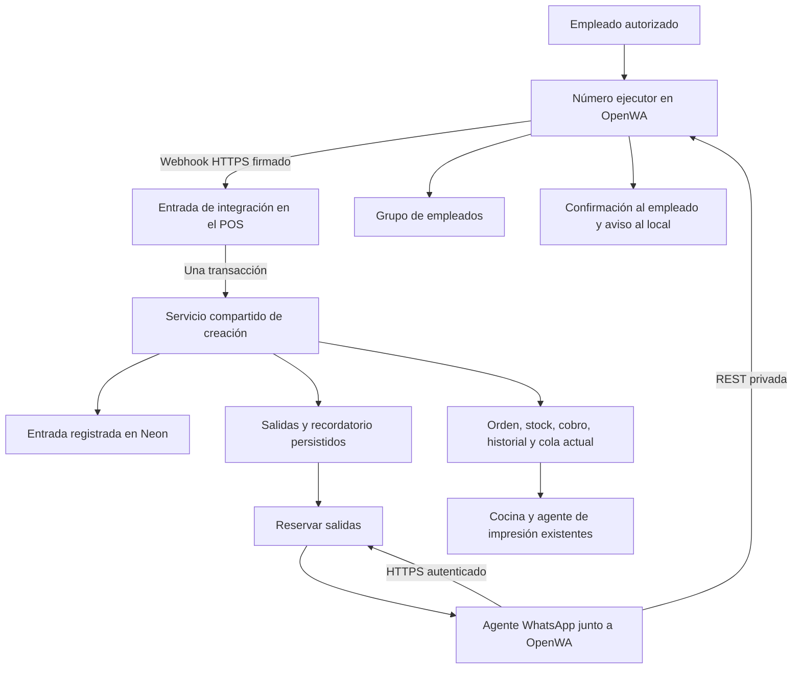

# Plan de implementación: órdenes por WhatsApp con OpenWA

Fecha: 2026-11-04, America/Guayaquil.
Estado: propuesta de implementación; este documento no activa la integración.
Base revisada: rama `develop`, commit `f611ec0`.
Herramienta elegida por el dueño: [rmyndharis/OpenWA](https://github.com/rmyndharis/OpenWA), publicado en open-wa.org. No confundir con `@open-wa/wa-automate` de openwa.dev: son proyectos distintos.

## Parte I. Qué estamos planteando y para qué

### 1. Problema actual

La persona que atiende WhatsApp conversa con el cliente, confirma productos, pago y entrega, publica la comanda en el grupo de empleados y después registra la orden en el POS. Más tarde vuelve a intervenir para pedir motorizado.

Ese flujo obliga a registrar la misma información en varios lugares. Puede producir diferencias entre la comanda del grupo y la orden de la aplicación, omisiones al pedir delivery y dudas cuando se modifica un pedido o se reenvía un mensaje.

La propuesta conserva la atención humana al cliente y automatiza el trabajo posterior a la confirmación. El número comercial continúa atendido por la persona encargada. Un segundo número, llamado **ejecutor**, está vinculado a OpenWA y recibe instrucciones únicamente del número del local, que hoy usa solo el empleado `digital`. OpenWA nunca se vincula al número del local.

### 2. Resultado esperado

Con un único mensaje completo enviado al ejecutor, el empleado podrá:

1. Registrar una venta en el POS con su identidad de usuario digital.
2. Recibir la confirmación con número de orden, total y situación operativa.
3. Publicar en el grupo una comanda construida desde los datos guardados en el POS.
4. Activar la cocina y la impresión mediante el circuito que ya existe.
5. Programar un aviso al número del local para pedir motorizado, cuando sea un domicilio.
6. Consultar la ubicación y registrar que el delivery ya fue solicitado.

El POS será la fuente de verdad de productos, precios, stock, dinero y estados. WhatsApp será la entrada del pedido y el canal de comunicación del equipo.

### 3. Alcance de la primera entrega

| Incluido | Resultado concreto |
|---|---|
| Un local, un ejecutor, un grupo de empleados y un destinatario de recordatorios | Configuración inicial pequeña y verificable. |
| Un operador autorizado: número del local vinculado al usuario `digital` existente | Una orden conserva creador, permisos y visibilidad en el canal digital. |
| Pedidos `domicilio` y `para_llevar` mediante plantilla de texto | Sin IA, audios, fotografías ni lectura de conversaciones completas. |
| Confirmación y errores al remitente | Un error de datos nunca se presenta como pedido aceptado. |
| Publicación de órdenes y correcciones relevantes en el grupo | El mensaje refleja los datos guardados y referencia la misma orden. |
| Ubicación por pin reenviado o enlace, y referencia de entrega | Enlace de Google Maps disponible para el operador y para coordinar el motorizado. |
| Aviso a los diez minutos y acción “Delivery solicitado” | Seguimiento operativo sin contratar automáticamente un repartidor. |
| Recuperación, deduplicación y revisión de fallos | Reiniciar o reintentar no debe crear otra venta. |
| Documentación de instalación y operación manual de respaldo | El equipo puede continuar atendiendo ante una caída del ejecutor. |

Quedan fuera de esta entrega: conversar automáticamente con clientes, aceptar pagos mediante el bot, verificar transferencias bancarias, interpretar cualquier texto libre, contratar delivery sin conocer el proveedor, rutas o tarifas de mapas, varias sucursales, campañas y mensajes masivos. Tampoco se reemplaza el agente de impresión ni se introduce una plataforma de colas genérica.

### 4. Reglas operativas propuestas

- Solo se envía al ejecutor un pedido acordado con el cliente. “Transferencia confirmada” significa que el empleado autorizado comprobó el ingreso; OpenWA no consulta el banco.
- El mensaje debe incluir el teléfono del cliente: no se deduce del número del empleado ni del encabezado de un reenvío.
- El pin del cliente se reenvía al ejecutor como mensaje siguiente al pedido. Se guarda en la única orden de domicilio sin ubicación de los últimos quince minutos; si hay varias, no se adivina y se completa desde el POS.
- Un pedido se considera registrado solo cuando el operador recibe la confirmación. Sin confirmación, se consulta el POS antes de reenviarlo o registrarlo manualmente.
- El empleado no numera pedidos. El POS reconoce un reenvío por el mensaje de WhatsApp y por el contenido normalizado dentro de una ventana inicial de treinta minutos.
- Si el pedido es inválido, no se crea nada. Se devuelve una lista concreta de datos que faltan o deben corregirse.
- Reenviar el mismo pedido dentro de la ventana devuelve la orden existente. Si el mismo teléfono (domicilio) o nombre (para llevar) tiene otra orden en la ventana con contenido distinto, no se crea nada: se indica modificar esa orden desde la aplicación. Si realmente es un segundo pedido, el operador reenvía la plantilla con `Nuevo pedido: sí`.
- En el piloto, la falta de stock se rechaza por defecto. La plantilla puede pedir explícitamente aprobación administrativa; en ese caso se conserva el circuito existente y se informa “Pendiente de aprobación”, no “En preparación”.
- Las modificaciones y anulaciones se realizan desde el POS con sus permisos actuales. El grupo recibe una actualización; editar o borrar un mensaje de WhatsApp no modifica ni anula una venta.
- Los recordatorios se generan únicamente para órdenes originadas por esta integración durante el piloto. Los domicilios manuales conservan su operación y pueden incorporar ubicación sin quedar sujetos al recordatorio nuevo.

Estas son decisiones de diseño propuestas para el piloto. La ventana de duplicados, el horario y el vocabulario se validarán con ejemplos del empleado antes de activar ventas reales.

### 5. Ejemplo de experiencia del empleado

**Formato acordado el 2026-11-05 tras revisar 25 pedidos reales. Reemplaza la plantilla con etiquetas de esta sección.** El operador sigue escribiendo en texto natural, en su chat privado con el ejecutor, y el parser acepta el orden libre de las líneas:

```text
Domiclio
Nombre del cliente (opcional, entre el tipo y el teléfono)
+593 9X XXX XXXX
combo mixto small
picante 1
1 cangrejo
efectivo $2.50
(notas para las personas, entre paréntesis)
https://maps.google.com/?q=... (opcional, enlace copiado del pin)
moto 10 (opcional, minutos para pedir la moto)
```

Actualizado el 2026-11-06 tras probar en desarrollo: la ubicación va como enlace de Google Maps en el mismo mensaje, porque un pin aparte queda ambiguo si otra orden reciente sigue sin ubicación. Sin enlace, la orden se crea con ubicación pendiente y se completa en el POS. El pin sigue aceptado como respaldo.

`moto N` fija cuántos minutos esperar antes del aviso, entre 0 y 120, y cuenta desde que el POS acepta la orden. Sin esa línea son 10 minutos. Si hay aprobación de stock, se conserva en la entrada y cuenta desde la aprobación. El tiempo lo decide el operador según cocina y clientes en el local; no se calcula automáticamente.

- Primera línea: `Domicilio` o `Domiclio`, o `Para retirar Nombre`. `Para servirse` se registra en el POS.
- Domicilio exige teléfono y valor del envío: `efectivo $2.50` o `trans $2.50`. `trans` significa transferencia recibida y su valor es lo que se paga al delivery.
- Para retirar no lleva envío ni ubicación. `trans` la deja pagada al crear; `efectivo` o nada la deja por cobrar en el local.
- Combos con picantes distintos van en líneas separadas o con `Natural y picante 1` después de `2 combo ...`.
- `Nuevo pedido` y `Solicitar aprobación` son líneas propias. El total lo calcula el POS.
- Los alias de productos solo incluyen formas confirmadas. `3 cangrejos` es el producto `3 Cangrejos` y otra cantidad usa `Cangrejo`. Camarón exige tamaño (1/2 o 1 lb) y es distinto de Langostinos. Camarón, salsas, michelada y cola se agregan al catálogo con el nombre que usa el operador.

Plantilla inicial; los productos entre corchetes se sustituyen por nombres del catálogo:

```text
PEDIDO
Tipo: domicilio
Cliente: Ana
Teléfono: +593XXXXXXXXX
Productos:
2 x [nombre exacto del producto] | natural
1 x [nombre exacto del producto] | picante 1 | sin cebolla
Pago: transferencia confirmada
Envío: 2.75
Ubicación: pin
Referencia de entrega: portón negro; llamar al llegar
Solicitar aprobación de stock: no
Observaciones: entregar los cubiertos aparte
```

La línea opcional `Nuevo pedido: sí` solo se usa cuando el POS avisó de otra orden reciente del mismo cliente y el operador confirma que es otro pedido.

`Ubicación` admite tres valores:

- `pin`: el empleado reenvió antes el pin del cliente. El ejecutor responde `Ubicación recibida. Se usará en el próximo PEDIDO.` El POS genera `https://www.google.com/maps?q=<latitud>,<longitud>` y la comanda sale completa una sola vez.
- Un enlace HTTPS de Google Maps, cuando el cliente envió un enlace.
- `pendiente`: el cliente aún no compartió su ubicación. La orden se crea sin enlace, el operador la completa desde el POS y el aviso de delivery lo indica.

Si llegan dos pines antes del `PEDIDO`, gana el último. Si la plantilla dice `pin` y no hay uno vigente, no se crea la orden y se solicita reenviarlo. Cada confirmación muestra cliente y enlace para que el operador revise el pin usado cuando atiende pedidos cruzados.

Para `para_llevar` se requiere nombre del cliente y se omiten envío, ubicación y modalidad de pago prevista, de acuerdo con el flujo actual. En domicilios por efectivo se escribe `Pago: efectivo`; no se marca la orden pagada.

La palabra `picante` sola es ambigua: se admiten `natural`, `leve`, `picante 1`, `picante 2` y `picante 3`, correspondientes a los niveles existentes. El nivel es obligatorio para productos que lo requieren. El separador ` x ` es obligatorio porque hay productos cuyo nombre empieza con número o fracción, como `3 Cangrejos` o `1/2 Libra Langostinos`.

Respuesta después de guardar:

```text
Orden #42 registrada · 04/11/2026
Estado: pendiente de preparación
Pago: transferencia confirmada por [empleado]
Total: [total calculado por el POS]
Publicación al grupo: pendiente
Impresión: en cola
Aviso para pedir delivery: [hora local]
```

La confirmación distingue “guardada”, “publicada” e “impresa”. Una impresión en cola no se anuncia como papel ya impreso. La publicación al grupo se construye con cantidades, nombres, picante, observaciones, total y modalidad reales guardados, más número diario y fecha. No se publica el mensaje original como si fuera el resultado de la API.

### 6. Cómo funciona el aviso de delivery

Propuesta inicial: el vencimiento es diez minutos después de que el POS acepta la orden para preparación. En una orden normal es la creación; si necesita aprobación de stock, es la aprobación administrativa. No se cuenta desde el primer mensaje del cliente ni desde la recepción de un mensaje inválido.

Al vencer, se envía al número del local el número de orden, tiempo transcurrido, estado actual, ubicación o aviso de `ubicación pendiente`, y acceso al pedido. El aviso solicita que una persona pida motorizado; no afirma que el pedido está listo.

La acción **“Delivery solicitado”** en el POS registra fecha y autor en el historial. La orden deja de generar ese recordatorio. Anular o rechazar la orden cancela los avisos que no hayan salido.

El pago y la logística se tratan por separado. Una orden por transferencia puede nacer pagada y seguir en preparación. Además, actualmente un cobro por QR puede poner `estado = cobrada` antes de una entrega física. Por tanto, ni `cobrada = true` ni `estado = cobrada` prueban que ya se pidió o entregó el delivery. El piloto no registra la entrega física: el aviso es único y lo cancela **“Delivery solicitado”**.

La primera versión enviará un solo recordatorio por orden; no habrá escaladas repetidas. Más adelante se podrá ajustar el plazo con tiempos observados de cocina y llegada del motorizado.

## Parte II. Cómo lo implementaremos

### 7. Base actual que debemos conservar

| Archivo o flujo revisado | Qué existe y qué debemos preservar |
|---|---|
| `app/api/ordenes/route.ts` | Autenticación, productos disponibles, cantidades, picante, stock, cálculo de precios y recargos, numeración, cobros e impresión. |
| `lib/session.ts` | Sesiones humanas por cookie y permisos de `admin`, `mesero`, `digital`; una cookie no es la credencial del bot. |
| `app/api/ordenes/route.ts`, filtro de listado | Digital ve sus propias órdenes. El actor de WhatsApp debe ser el usuario real del empleado, no un administrador compartido. |
| `lib/caja.ts` y `lib/order-creation.test.ts` | La creación de `mesero` exige caja abierta; `digital` no se bloquea por caja. |
| `app/api/ordenes/aprobacion/{aprobar,rechazar}/route.ts` | Aprobación de stock y tratamiento existente de pagos y rechazos. |
| `app/api/ordenes/[id]/{items,anular}/route.ts` | Cambios y anulación auditados, permisos y control de concurrencia existentes. |
| `lib/order-payment.ts` | Cobrar y entregar no son equivalentes. No modificar reglas financieras para resolver logística. |
| `lib/print-jobs.ts`, `lib/print-agent-jobs.ts` | Snapshot, deduplicación, reserva temporal de trabajos, reintentos y confirmación. Copiar el patrón donde corresponda, sin mezclar mensajes con `PrintJob`. |
| `lib/print-agent-auth.ts` | Patrón de autenticación de un agente; usar credenciales independientes para WhatsApp. |
| `lib/employee-consumption.ts`, `lib/employee-consumption.postgres.test.ts` | Comparación de hash dentro de la transacción y arnés de PostgreSQL aislado. Reutilizar ambos patrones. |
| `components/mesero/CrearOrden.tsx` | Formulario compartido; incorporar ubicación sin romper la creación manual. |
| `amplify.yml` | Las variables del servidor se transfieren mediante lista explícita. Las nuevas deben incorporarse a esa lista. |

En el esquema y contrato actuales no existe un campo específico `direccion` ni `ubicacion`. Este cambio agrega ubicación estructurada; si el equipo está usando observaciones como dirección, esos textos históricos se conservan, sin convertirlos automáticamente en enlaces.

### 8. Arquitectura elegida



Componentes nuevos mínimos:

1. **OpenWA**, alojado en la computadora Windows dedicada de 64 bits con 8 GB, con su volumen persistente. Su SQLite almacena datos técnicos propios del gateway; no replica las ventas de Neon.
2. **Entrada HTTPS en el POS**, que autentica el evento y, en una sola transacción, registra la entrada, crea la orden y guarda sus salidas antes de confirmar.
3. **Servicio de órdenes compartido**, extraído del código existente para que la web y WhatsApp ejecuten las mismas reglas.
4. **Agente WhatsApp**, proceso Node pequeño en Docker junto a OpenWA: solicita trabajo al POS, envía mediante REST local y confirma resultados.
5. **Tablas de entradas y salidas en Neon**, más metadatos mínimos en las órdenes.

El agente tendrá acceso a las APIs necesarias, no credenciales directas de Neon. No se abre OpenWA a internet para que Amplify lo invoque. El webhook sale desde OpenWA hacia la URL pública del POS; el agente consulta el POS mediante conexiones salientes. Esto también funciona detrás del router del local.

No se agrega Lambda, Redis, SQS, n8n ni otro PostgreSQL para este alcance. Se usa el motor con navegador de OpenWA como punto de partida del piloto; pasar a Baileys será una decisión basada en compatibilidad y mediciones, no una promesa de ausencia de bloqueos.

### 9. Modelo de datos propuesto

Los nombres siguientes son propuestos; no constituyen una migración aplicada.

#### 9.1 Campos de `Orden`

| Campo | Uso |
|---|---|
| `ubicacionUrl String?` | Enlace de entrega validado o generado por el POS desde un pin. |
| `referenciaEntrega String?` | Indicaciones complementarias. |
| `deliverySolicitadoAt DateTime?` | Confirmación operativa de que alguien pidió motorizado. Autor registrado en historial. |

El hash de contenido incluye los datos comerciales de la plantilla normalizada, conservando los nombres escritos normalizados; excluye precios recalculados, timestamps e ID del nuevo mensaje. Los IDs de productos resueltos se guardan con el resultado, pero no obligan a consultar de nuevo el catálogo para reconocer un reenvío.

Dentro de la ventana se compara primero el hash, antes de validar disponibilidad contra el catálogo actual. Se conserva el total original: un cambio posterior de precio, nombre o stock no convierte el mismo mensaje en otra venta. Dos textos con nombres o alias diferentes se consideran contenido distinto, aunque pudieran apuntar al mismo producto; el operador recibe la orden existente para revisarla.

Los campos son opcionales para datos históricos. La línea `Ubicación` será obligatoria en domicilios recibidos por WhatsApp y admitirá `pin`, enlace o `pendiente`; el formulario manual permitirá incorporarla durante el piloto sin invalidar órdenes antiguas. Exigirla para todo domicilio manual será una activación posterior explícita de esa regla.

#### 9.2 `WhatsappEntrada`

Guardar: ID interno, tipo (`PEDIDO` o `UBICACION`), sesión, ID del mensaje original, clave de entrega del gateway, identidad de remitente, usuario resuelto, timestamp original, recepción, texto limitado, datos normalizados, `requestHash`, estado, orden asociada y error resumido.

`requestHash` es el hash del pedido normalizado para reconocer reenvíos dentro de la ventana, con índice junto a `recibidaAt`. Vive en la entrada y no en `Orden`: la orden se alcanza por `ordenId` y ninguna respuesta de orden puede exponer el hash.

Restricciones y comportamiento:

- Unicidad por `(sessionId, messageId)`. La clave del webhook sirve de defensa adicional; no se usa el ID de cada intento de entrega como identidad del pedido.
- Estados: `CREADA`, `INVALIDA`, `IGNORADA`, `REQUIERE_REVISION`, `UBICACION_DISPONIBLE`, `UBICACION_USADA`. La entrada se inserta con su resultado dentro de la transacción; no hay reservas ni reintentos propios.
- Una entrada `UBICACION` guarda solo latitud y longitud validadas en sus datos normalizados. Un pin nuevo marca como `IGNORADA` la ubicación disponible anterior. Tras el umbral inicial de quince minutos, una ubicación sin usar pasa a `IGNORADA`.
- Un mensaje inválido es terminal. El empleado corrige y envía un mensaje nuevo; al no existir una venta, podrá procesarse.
- Una entrada antigua recuperada después de una desconexión se pone en revisión antes de crear comida automáticamente. Umbral inicial propuesto: quince minutos desde el timestamp original, sujeto al ensayo operativo. Si su hash ya tiene orden dentro de la ventana, devolver esa orden antes de aplicar el control de antigüedad; la revisión protege nuevas creaciones, no impide reconocer resultados anteriores.
- No persistir el cuerpo bruto con archivos, claves o todo el historial del chat. Guardar únicamente lo necesario para procesar y explicar la operación.

#### 9.3 `WhatsappSalida`

Guardar: ID, sesión, orden/entrada asociada, tipo, destino, texto inmutable del intento, clave única, fecha disponible, vencimiento, estado, intentos, reserva/expiración, identificador de mensaje devuelto por OpenWA y último error.

Tipos iniciales: `RESPUESTA_EMPLEADO`, `PUBLICACION_GRUPO`, `ACTUALIZACION_GRUPO`, `RECORDATORIO_DELIVERY`.

Estados: `PENDIENTE`, `PROCESANDO`, `REINTENTO`, `ENVIADA`, `CANCELADA`, `REQUIERE_REVISION`.

- `ENVIADA` significa aceptada por el gateway con identificador de mensaje, no leída por el destinatario. Las confirmaciones de WhatsApp se reflejan solo si realmente se reciben.
- La clave de salida es estable por acción lógica: creación, evento de historial, respuesta a entrada o recordatorio de una orden.
- Índices por estado y fecha disponible; la reserva permite recuperar trabajo tras una caída.
- No reutilizar `printRevision` para cualquier cambio de ubicación: la identidad de una actualización del grupo puede derivarse del ID de su evento de historial.

No se crea un catálogo nuevo de empleados. La identidad del número del local y su usuario `digital` se configuran en servidor; pueden registrarse sus formas `@c.us` y `@lid` observadas en la Fase 0. Se comprueba en cada procesamiento que el usuario sigue activo y tiene rol `digital`; una baja revoca el acceso aunque el número permanezca en la configuración. Si otro empleado debe cubrir el turno, usa el formulario del POS hasta que se actualice esa configuración.

### 10. Recepción y autenticación del mensaje

Ruta nueva propuesta: `POST /api/integraciones/whatsapp/webhook`.

Secuencia:

1. Limitar el cuerpo a un tamaño definido para texto y ubicación. Configurar en OpenWA `events` y `filters` con `fromMe = false`, `isGroup = false` y `type` en `text` o `location`, verificando con una muestra real que el filtro no descarte ubicaciones. Muestra de la Fase 0 con `whatsapp-web.js`: un pin pesó 4,772 bytes y un sticker de grupo 932,961 bytes, por `data.media`. Sin este filtro esos eventos reciben `413` y consumen reintentos.
2. Leer bytes originales y verificar HMAC-SHA256 con comparación constante. Validar firma antes de confiar en los campos.
3. Validar sesión configurada, evento, identificador, timestamp y estructura del mensaje de la versión fijada de OpenWA.
4. Aceptar solamente mensajes privados entrantes del número del local: texto con prefijo `PEDIDO` o mensaje de tipo `location`. Ignorar mensajes propios, del grupo y eventos de edición/revocación para evitar bucles.
5. Resolver la identidad del remitente, contemplando los identificadores `@lid` de WhatsApp. No extraer un supuesto teléfono quitando sufijos de cualquier ID.
6. Ejecutar una transacción corta con el servicio de la sección 12. Si `(sessionId, messageId)` ya existe, devolver éxito sin repetir efectos.
7. Responder `2xx` después del commit. Si la transacción falla por una causa transitoria, nada queda guardado y se devuelve un error recuperable para que el gateway reintente.

El webhook no espera impresión, envío al grupo ni diez minutos: esos efectos quedan como salidas o trabajos persistidos, y las órdenes de WhatsApp usan la cola de impresión, no la impresión directa. La transacción debe terminar dentro del timeout de diez segundos del webhook. Si el gateway reintenta después de un commit, la unicidad del mensaje evita repetir la venta.

Los reintentos del gateway cubren cortes breves, no una caída larga: la configuración documentada admite hasta cinco intentos, con esperas de 5, 10, 20 y 40 segundos. Configurar `retryCount: 5` y una retención acotada mediante `WEBHOOK_FAILURE_PAYLOAD_RETENTION_HOURS`, porque el valor por defecto `0` impide reenviar fallos con `POST /api/webhooks/delivery-failures/redrive`. Si los intentos se agotan, el operador no recibirá confirmación y debe aplicar la regla de la sección 4 mientras se revisa `GET /api/webhooks/delivery-failures`.

Un evento válido pero irrelevante se reconoce sin crear trabajo. Un remitente desconocido no recibe información del negocio. Una firma inválida se rechaza. Un formato de pedido incorrecto de un empleado autorizado genera una respuesta de corrección mediante la cola, no una tormenta de reintentos HTTP.

El contrato de `rmyndharis/OpenWA` utiliza un sobre con `event`, `sessionId`, `timestamp` y `data`. Muestra real de `whatsapp-web.js` en OpenWA 0.27.1: `data` trae `id`, `from`, `to`, `chatId`, `body`, `type`, `timestamp` en segundos, `fromMe`, `isGroup`, `kind`, `isLidSender` y, en un pin, `location.latitude` y `location.longitude`; el `body` de un pin es su miniatura. El remitente y el chat privados pueden llegar como `@lid`. No se copiará el formato de `payload.message` del otro proyecto OpenWA.

### 11. Interpretación sin IA

Crear una función pura que convierta el texto en un pedido normalizado o una lista de errores. Debe poder probarse sin WhatsApp, red ni base.

Reglas:

- Admitir variaciones de espacios, mayúsculas y tildes en etiquetas; rechazar campos duplicados contradictorios.
- Productos por coincidencia normalizada exacta con el catálogo. Empezar sin búsqueda aproximada; un alias se añade únicamente si surge de ejemplos reales y no es ambiguo. `Producto.nombre` no es único: si la coincidencia devuelve varios productos, se rechaza.
- Una línea exige el formato `<cantidad> x <producto>`. El mismo producto puede repetirse en varias líneas con distinto picante u observación; el stock se valida por la suma de sus cantidades.
- Cantidades enteras positivas; límites explícitos de longitud, líneas y cantidades para evitar entradas accidentales enormes.
- Dinero con máximo dos decimales y envío no negativo; nunca interpretar el importe de envío como monto de la transferencia.
- Teléfono normalizado al formato internacional acordado para la operación; errores se corrigen antes de crear la orden.
- Picante contra los niveles existentes, obligatorio donde corresponde; no deducir intensidad.
- Domicilio con teléfono y envío; la ubicación llega como pin en el mensaje siguiente o como enlace HTTPS permitido en el pedido. Para llevar con nombre; sin programar delivery.
- Transferencia requiere la expresión explícita `transferencia confirmada`. `Transferencia pendiente` o `trans` sin confirmación no autoriza registrar dinero recibido.
- Ubicación como enlace de Google Maps en hosts expresamente permitidos, incluido `maps.app.goo.gl`, sin credenciales ni esquemas alternativos. Guardar el enlace sin descargarlo, seguir redirecciones ni geocodificarlo. Validar la forma del enlace no demuestra que el punto sea correcto: el operador lo revisa.
- Pin: leer `location.latitude` y `location.longitude`, validar rangos y rechazar `0,0`, porque el motor Baileys usa `0` cuando falta una coordenada. Generar el enlace en el POS; no usar `location.url` ni el texto recibido. `quotedMessage` solo trae `id` y `body`, por lo que citar un pin no aporta coordenadas.
- Audios, imágenes y mensajes repartidos en varias partes quedan fuera del parser inicial; la excepción es el pin previo al `PEDIDO`. Se responde solicitando la plantilla completa cuando corresponda.

Se conservará un conjunto anonimizado de ejemplos reales como fixtures. El ejemplo de este documento es una propuesta de sintaxis, no una plantilla ya implementada.

### 12. Servicio compartido de creación e idempotencia

Extraer la lógica comercial de `POST /api/ordenes` a `lib/order-creation.ts`. La ruta web continúa autenticando su cookie y obtiene el actor desde la sesión; la integración obtiene el actor desde la identidad autorizada. Ninguna acepta `creadorId` o rol arbitrario del texto.

No llamar al endpoint humano simulando una cookie ni copiar sus aproximadamente quinientas líneas a otra ruta. La extracción conserva validaciones, errores, cálculos y efectos actuales; se demuestra con las pruebas de creación antes y después.

La creación de WhatsApp ejecuta en la misma transacción:

1. Tomar `pg_advisory_xact_lock` por operador, insertar la entrada y buscar en la ventana el mismo hash u otra orden del mismo cliente.
2. Crear orden y número diario, aplicar las reglas actuales de stock y pago, registrar historial y trabajo de impresión cuando corresponda.
3. Vincular la entrada con la orden y marcarla procesada; si usa `pin`, tomar la ubicación vigente y marcarla `UBICACION_USADA`.
4. Guardar la respuesta al empleado y la publicación al grupo.
5. Guardar el recordatorio disponible en diez minutos si la orden fue aceptada para preparación.

El bloqueo por operador impide que dos mensajes concurrentes creen la misma venta. La unicidad de `(sessionId, messageId)` es la última defensa ante reintentos del gateway: si otro proceso ganó, devolver éxito sin repetir stock, cobro o impresión.

Para un pedido ya conocido, resolver primero el reenvío antes de exigir otra vez stock disponible o un pin vigente. El contenido persistido permite reconocer un pedido incluso si el producto dejó de estar disponible después. El hash conserva el valor literal `pin`, no las coordenadas. Un pedido inválido no consume la ubicación.

La falta de stock se comprueba antes de la transacción con la suma por producto y devuelve los productos afectados como error definitivo. `StockConflictError` queda solo para una carrera real y es el único caso de stock que puede reintentarse. Hoy la ruta valida cada línea por separado y el mensaje `El stock cambio…` no sirve para corregir un pedido.

Fallos de red posteriores al commit de la orden no deben convertirla en un error que invite a crear otra. SSE e impresión directa son efectos posteriores; sus fallos se reportan separadamente. La cola de impresión continúa teniendo su confirmación transaccional actual.

Si se requiere aprobación de stock, no publicar una comanda ordinaria ni crear el recordatorio todavía: se envía una confirmación privada de la situación. Aprobar registra publicación y recordatorio en la misma transacción de aprobación; rechazar notifica al empleado y conserva el tratamiento financiero existente.

### 13. Agente de envío y recuperación

Ubicación propuesta: `whatsapp-agent/`, con un proceso Node, configuración por entorno y `fetch` nativo. No añadir SDK si las pocas llamadas REST necesarias se resuelven claramente con la biblioteca estándar.

API interna propuesta, con Bearer exclusivo del agente:

| Endpoint | Responsabilidad |
|---|---|
| `POST /api/whatsapp-agent/tick` | Reservar como máximo una salida disponible y registrar salud del agente. Operación corta y limitada por solicitud. |
| `POST /api/whatsapp-agent/salidas/[id]/complete` | Confirmar el resultado y guardar `messageId`; exige propietario y token de la reserva vigente. |
| `POST /api/whatsapp-agent/salidas/[id]/fail` | Clasificar el fallo, programar reintento seguro o pasar a revisión. |

`tick` solo reserva salidas: una orden creada no depende de que el agente esté activo, pero su confirmación sí. Pines y pedidos se atienden en el orden en que llegan al webhook; si un `PEDIDO` llega antes que su pin, se rechaza sin efectos y el operador lo reenvía.

La reserva de salida es atómica y devuelve un token aleatorio por reserva. La confirmación comprueba ese token, no solo un `workerId` reutilizable. Una respuesta de un intento antiguo no puede completar una reserva nueva.

Para enviar:

1. Comprobar que la sesión de OpenWA esté lista antes de reservar trabajo que requiera enviar.
2. Consultar el POS y recibir destino y texto autorizado. El agente no tiene un endpoint público para enviar a cualquier número.
3. Llamar a `POST /api/sessions/{sessionId}/messages/send-text` en la API privada de OpenWA, con `X-API-Key` y `Idempotency-Key` estable.
4. Persistir el resultado mediante `complete`; ante fallo, usar `fail` y la misma clave en el siguiente intento seguro.

La respuesta inicial, la comanda y el recordatorio son salidas independientes. Un fallo al publicar en el grupo no vuelve a ejecutar la venta. Las actualizaciones de una misma orden conservan su orden causal; una creación pendiente de resolución no debe quedar detrás de su corrección en el grupo. El bloqueo de una orden no detiene las demás.

Parámetros iniciales propuestos: una sesión y un agente activo, sondeo cada cinco segundos durante el horario configurado, espera mayor cuando esté vacío o desconectado, reserva de sesenta segundos y envío HTTP limitado a treinta segundos. Validarlos con el motor real; renovar o ampliar la reserva si una operación pudiera superar ese plazo.

Un sondeo constante a cinco segundos durante ocho horas por veintiséis días supone unas 149.760 llamadas mensuales. Medir actividad de Neon y consumo de Amplify; aplicar espera progresiva cuando no hay trabajo, aceptando mayor latencia después de inactividad. No prometer que el costo de la aplicación seguirá siendo el actual. El recordatorio puede salir unos segundos después del vencimiento según el intervalo de sondeo.

No crear un bucle permanente dentro de una petición de Next.js. Los timers del agente sirven para despertarlo; el trabajo y el vencimiento siempre se reconstruyen desde la base al reiniciar.

#### 13.1 Política de fallos de envío

| Resultado | Acción |
|---|---|
| Sesión no lista antes del intento | No enviar; conservar pendiente y aplicar espera progresiva. |
| Rechazo probado antes de enviar | Corregir configuración o reintentar con la misma clave cuando sea recuperable. |
| Limitación de frecuencia | Respetar el plazo informado; no bombardear el gateway. |
| Respuesta de éxito perdida | Repetir misma ruta, cuerpo y clave dentro de la ventana admitida. |
| `IDEMPOTENCY_KEY_IN_PROGRESS` | Esperar y consultar/reintentar con la misma clave. |
| `IDEMPOTENCY_OUTCOME_UNKNOWN`, timeout ambiguo o pérdida del volumen de OpenWA | Revisión; el agente no reintenta. Una persona revisa el chat, envía el mensaje a mano si no salió y descarta la salida. La misma clave seguirá devolviendo `409` hasta terminar su ventana. |
| Clave/cuerpo incompatibles | Error de implementación o configuración; detener esa salida y revisar. |
| Se agotaron intentos o pasó el vencimiento operativo | Revisión visible en el POS. No reenviar automáticamente mensajes antiguos. |

La documentación del gateway limita la retención de claves a veinticuatro horas. Mantener deduplicación propia en Neon y pasar a revisión antes de reintentar fuera de esa ventana. La persistencia del gateway y la del POS se respaldan por separado.

### 14. Programación y estado de delivery

- Crear el trabajo con `availableAt = aceptación + 10 minutos` en la misma transacción que habilita la preparación.
- Antes de reservarlo, comprobar domicilio, ausencia de anulación/rechazo y `deliverySolicitadoAt = null`.
- Al ejecutar “Delivery solicitado”, actualizar orden, historial y cancelar recordatorios no enviados en una sola transacción. La acción debe ser idempotente y permitirla solo al creador digital o un administrador.
- No inferir entrega desde un cobro por QR. No se agrega un campo de entrega física: cocina termina en `lista` y `entregada` solo se marca desde el detalle administrativo, así que quedaría casi vacío.
- Registrar el autor mediante el historial existente. No permitir al agente marcar que se contrató un motorizado simplemente porque envió el recordatorio.
- Releer elegibilidad al reservar. Existe una ventana inevitable entre esa comprobación y el envío externo: una acción humana simultánea puede dejar salir un aviso redundante. El mensaje debe pedir verificar el estado, sin contratar automáticamente nada.
- Si un recordatorio se recupera más de treinta minutos después de su vencimiento, ponerlo en revisión en lugar de enviarlo. Umbral inicial propuesto, sujeto a ensayo.
- Si una modificación agrega comida, publicar el cambio. En el piloto no recalcular automáticamente el plazo de diez minutos; mostrar el estado real y permitir pedir el delivery manualmente. Un cálculo dinámico requiere evidencia de tiempos operativos.

Ruta humana propuesta: `PATCH /api/ordenes/[id]/delivery`, con acción `solicitar`; sesión por cookie, control de propiedad y auditoría. En el piloto “solicitar” registra lo que la persona hizo fuera del sistema; la interfaz debe decirlo claramente.

### 15. Ubicación, cambios y publicación al grupo

Agregar ubicación y referencia a tipos, validación y persistencia. Mostrar enlace seguro en pedidos digitales y detalle administrativo; permitir editar desde el detalle mediante una mutación específica con historial. Mantener acceso por propietario o administrador.

No mandar enlaces completos de mapas a la impresora en esta entrega: el operador y el motorizado los usarán en pantalla o WhatsApp. Si se imprime referencia de entrega, extender el snapshot como dato opcional y verificar ambos agentes antes de activarlo. Esta ampliación de impresión no bloquea el piloto si el dato ya está disponible en POS y grupo.

En creación, aprobación, cambios de items, cambios de ubicación, rechazo y anulación, guardar una salida coherente con el evento dentro de su transacción. Las rutas que hoy mutan sin transacción deben envolver solo los cambios relacionados necesarios; no reestructurar todo el módulo.

Publicar mensajes nuevos que referencien número diario y fecha, como “ACTUALIZACIÓN de orden #42”, en lugar de depender de editar el mensaje original. Cada salida se identifica por su evento de historial y conserva un snapshot. Una salida ya intentada nunca cambia de cuerpo conservando la misma clave de envío.

Una actualización pagada conserva las reglas vigentes de diferencias y cobros. El bot no aprueba descuentos, cortesías, reembolsos ni cambios de dinero.

### 16. Configuración y seguridad

Configuración propuesta del POS:

- `WHATSAPP_ENABLED`: desactivada por defecto; detiene nuevas creaciones y permite reconocer de forma durable los eventos recibidos como suspendidos/revisables.
- `WHATSAPP_SEND_ENABLED`: pausa envíos sin borrar la cola ni ejecutar ventas nuevas por sí misma.
- Ambas banderas sirven como estado de despliegue, no como pausa de emergencia: `amplify.yml` escribe `.env.production` durante el build y cambiarlas exige un redeploy. La pausa inmediata consiste en detener el gateway y el agente.
- `WHATSAPP_WEBHOOK_SECRET`: verificación del gateway; independiente del token del agente.
- `WHATSAPP_AGENT_TOKEN`: credencial larga del agente; comparación segura siguiendo el patrón existente.
- `WHATSAPP_SESSION_ID`, `WHATSAPP_GROUP_CHAT_ID`, `WHATSAPP_LOCAL_CHAT_ID`.
- `WHATSAPP_OPERATOR_IDS`: identidades canónicas del número del local, separadas por coma.
- `WHATSAPP_OPERATOR_USER_ID`: ID del usuario `digital` que crea las órdenes. No se acepta un rol declarado por el mensaje.
- `NEXT_PUBLIC_APP_URL`: revisar el uso actual para generar enlaces con el origen canónico; una variable pública nunca contiene claves.

Configuración del agente: URL HTTPS del POS, token exclusivo, URL local de OpenWA, clave de operador del gateway, ID de sesión y horario en `America/Guayaquil`.

Configuración de OpenWA: versión exacta e imagen fijada por digest, volumen persistente privado, `AUTO_START_SESSIONS=true`, webhook HTTPS firmado, filtro de eventos, `retryCount: 5` y retención acotada de fallos. La política de reinicio del contenedor por sí sola no prueba que la sesión vuelva a conectarse.

Controles:

- Publicar REST y dashboard de OpenWA solo en loopback o red privada. Acceso administrativo desde el propio equipo o mediante acceso remoto protegido; no exponer QR ni credenciales.
- Restringir la clave de envío del agente a la sesión y chats previstos cuando el gateway lo permita. Registrar webhooks con una credencial de administración separada.
- Mantener una única instancia dueña de la sesión; reservas en Neon para evitar dos consumidores del mismo trabajo.
- No registrar secretos, texto completo ni enlaces privados en logs. Usar entrada, orden, salida y códigos de error.
- Estado visible del último contacto del agente y trabajos que requieren revisión dentro del panel existente; no construir otro dashboard completo.
- La limpieza automática del texto de entrada queda fuera del piloto. Antes de ampliar el uso, definir retención y limpieza, conservando deduplicación y vínculo de auditoría de la venta. No borrar historial comercial.
- Actualizar `amplify.yml` con las variables privadas necesarias sin imprimir sus valores. Los archivos del agente y de OpenWA quedan fuera del control de versiones.

### 17. Alojamiento y operación

Host elegido: computadora Windows nueva de 64 bits con 8 GB, dedicada a OpenWA y al agente. No se usa la Mac ni la Ubuntu del local. La documentación del gateway admite Windows y orienta a unos 2 GB para su motor con navegador, pero su guía específica es escasa: la Fase 0 debe demostrarlo en este equipo.

Requisitos del equipo:

- Docker Desktop con WSL2 y virtualización activa en BIOS/UEFI.
- Volumen Docker con nombre para los datos; respaldo mediante exportación desde el contenedor.
- Límite de memoria de WSL2, inicialmente 4 GB, y contenedor de OpenWA limitado a 2 GB.
- Sin suspensión ni hibernación, con reinicios de Windows Update fuera del horario de atención.
- Inicio automático de Windows y Docker Desktop sin intervención, y restauración de energía en BIOS/UEFI si existe.
- `WWEBJS_AUTH_TIMEOUT_MS=120000`, por la nota de OpenWA sobre arranques lentos en WSL2.

Si este equipo no aprueba la Fase 0, usar una VM pequeña; Lightsail es una opción compatible con la propuesta, no un recurso que este documento haya creado. El equipo de impresión de 32 bits, si continúa siendo el actual, se mantiene para impresión y no se toma como host soportado del gateway.

Referencia presupuestaria de la investigación: Lightsail Linux con IPv4 ofrece 2 GB a USD 12/mes y 4 GB a USD 24/mes. Para una sesión con navegador, probar primero 2 GB y medir; no afirmar que esa capacidad está validada. El presupuesto adicional comprende host, impuestos, línea, respaldos y consumo incremental de Amplify/Neon por webhook y sondeo. Un equipo local evita el alquiler del host, pero añade electricidad, conectividad y mantenimiento. Verificar [precios de Lightsail](https://aws.amazon.com/lightsail/pricing/) y región al contratar; no asumir créditos gratuitos ni sumar compra de equipo y alquiler de VM como requisitos simultáneos.

En el host ejecutar únicamente OpenWA y el agente de esta integración. Configurar inicio tras reinicio, persistencia, rotación de logs, reloj sincronizado y respaldo/restauración del volumen. Documentar cómo volver a vincular el número si la sesión expira.

El teléfono principal del ejecutor tiene un responsable nombrado y una revisión semanal. Fuentes secundarias indican que los dispositivos vinculados se cierran si ese teléfono pasa catorce días sin uso; verificar la regla vigente y conservar la línea activa.

Actualizar OpenWA es una tarea planificada: el proyecto tiene una cadencia alta y depende de un mantenedor principal. Cada cambio de digest se prueba antes con número y grupo de ensayo, y se conserva el digest anterior para volver atrás. Además, ya existe una incidencia abierta donde el auto-pin de `whatsapp-web.js` deja sesiones fallando durante veinticuatro horas; el procedimiento manual debe cubrir ese escenario.

Si se aloja en nube, una caída de internet del local puede dejar órdenes y publicaciones creadas mientras la impresora está desconectada. Mostrar impresión pendiente y continuar el procedimiento manual. No confundir disponibilidad del ejecutor con disponibilidad de cocina o papel.

## Parte III. Fases, pruebas y activación

### 18. Fases de implementación

Cada fase termina con una condición verificable. La escritura de este plan no ejecuta las fases.

#### Fase 0. Ensayo de OpenWA y cierre de datos operativos

- [ ] Revisar muestras anonimizadas de pedidos reales, vocabulario y cambios frecuentes.
- [ ] Definir ventana de duplicados, identidad del número del local, usuario `digital` del operador, grupo y horario.
- [ ] Preparar la computadora Windows con los requisitos de la sección 17 y usar `whatsapp-agent/ensayo/`.
- [ ] Verificar edición de Windows, virtualización, memoria y conectividad hacia el POS.
- [ ] Comparar `whatsapp-web.js` y Baileys, incluido qué ocurre con mensajes enviados durante un corte; fijar motor y digest de OpenWA según el resultado.
- [ ] Registrar muestras anonimizadas de webhook: texto, pin reenviado y remitente del número del local, para confirmar `@c.us` o `@lid`.
- [ ] Confirmar que el filtro por tipo no descarte ubicaciones y comprobar si una ubicación en tiempo real se puede reenviar. Si no se puede, pedir pin normal o usar `pendiente`.
- [ ] Probar con número y grupo de ensayo recepción, envío, HMAC, repetición con misma clave, reinicio y autoconexión.
- [ ] Reiniciar Windows y simular corte de energía: OpenWA debe volver sin iniciar sesión manualmente ni escanear QR.
- [ ] Mantener el ejecutor activo siete días en este equipo y registrar sesión, memoria y reinicios.
- [ ] Forzar agotamiento de reintentos y comprobar registro y reenvío de fallos.
- [ ] Nombrar responsable del teléfono del ejecutor y verificar la regla de sesión vinculada.
- [ ] Validar los umbrales propuestos de quince minutos para entrada antigua y pin sin usar, y treinta minutos para aviso vencido.

Salida: evidencia del circuito técnico funcionando sin crear ventas reales; configuración y plantilla definidas. Si el gateway no reconecta o no publica de forma confiable, resolverlo antes de integrar dinero y stock.

#### Fase 1. Proteger y extraer la creación existente

- [x] Ejecutar `test:order-creation` y `test:employee-sales-boundaries` como línea base.
- [x] Extraer `lib/order-creation.ts`, conservando actor, validación, transacción y respuesta.
- [x] Validar stock por suma de producto y devolver un error definitivo con los productos afectados.
- [x] Mantener la ruta humana con sus permisos y errores existentes.
- [x] Separar errores posteriores al commit del resultado comercial.
- [x] Probar roles, caja, pagos, stock concurrente, numeración e impresión en cola. La carrera de stock se probó con un doble en memoria; la concurrencia real sobre PostgreSQL queda en la Fase 4.

Salida: la creación web tiene el mismo comportamiento comprobado. No activar todavía WhatsApp.

#### Fase 2. Migración aditiva y ubicación

- [x] Agregar campos opcionales de orden, entradas, salidas, restricciones e índices.
- [x] Preparar migración y revisar su SQL sin reinicializar ni borrar datos.
- [x] Extender tipos y serializers sin exponer hashes o metadatos internos innecesarios al cliente.
- [x] Incorporar ubicación/referencia en formulario, detalle y mutación auditada.
- [x] Incorporar registro de delivery solicitado independiente del pago. La ruta existe; el botón y la cancelación de recordatorios quedan en la Fase 6.
- [x] Probar sobre PostgreSQL aislado que filas históricas continúan operando. Se aplicaron las migraciones en PGlite (PostgreSQL 18 WASM); los agentes de impresión no se ejecutaron: no leen columnas nuevas y el snapshot no cambió.

Salida: compatibilidad con órdenes antiguas y datos nuevos disponibles con la integración apagada.

#### Fase 3. Parser, identidad e ingreso durable

- [x] Implementar normalización y validación de la plantilla con fixtures.
- [x] Implementar HMAC, límites de cuerpo y validación del sobre de OpenWA.
- [x] Implementar la identidad del número del local y su vinculación con usuario activo.
- [x] Guardar entradas y deduplicar por mensaje; tratar eventos antiguos y no relevantes.
- [x] Recibir pin, validar coordenadas, conservar el último vigente y responder al operador.
- [x] Probar que ninguna entrada inválida o no autorizada escribe ventas, cobros o stock.

Salida: recepción verificable y respuestas de error persistidas, aún en entorno de ensayo.

Contrastado el 2026-11-05 con muestras reales del webhook y 25 pedidos anonimizados; el número del local llega como `@lid`.

#### Fase 4. Creación idempotente y salidas transaccionales

- [x] Integrar parser con servicio compartido dentro de la transacción del webhook, con bloqueo por operador y detección de reenvíos.
- [x] Consumir el pin vigente dentro de la transacción y generar `ubicacionUrl`.
- [x] Escribir entrada procesada, orden, efectos comerciales y salidas en la misma transacción.
- [x] Conectar aprobación/rechazo con publicaciones y programación diferida.
- [x] Construir plantillas del grupo desde snapshots guardados.
- [x] Probar concurrencia real, pérdida de respuesta y rollback con PostgreSQL aislado.

Salida: un pedido produce una sola venta, un solo efecto de stock y los cobros previstos, aunque se repita.

#### Fase 5. Agente y envío recuperable

- [x] Implementar reserva atómica, token por reserva y recuperación de expirados.
- [x] Implementar agente y rutas internas de trabajo/resultado.
- [x] Usar claves estables del gateway, clasificar resultados desconocidos y conservar cuerpos inmutables.
- [x] Respetar orden de publicaciones por pedido y permitir avanzar otros pedidos.
- [ ] Configurar reinicio, sondeo con espera progresiva, horario y salud visible. Hecho salvo la vista en el POS: la salud queda en `PrintAgent` con id `whatsapp-agent` y se muestra en la lista de revisión de Fase 6.
- [x] Probar caídas antes/después del envío y antes/después de confirmar al POS.

Salida: reiniciar no pierde trabajos ni reenvía ciegamente mensajes inciertos.

#### Fase 6. Delivery y cambios operativos

- [ ] Programar desde aceptación o aprobación, con reloj del servidor.
- [ ] Incorporar elegibilidad, expiración y cancelación por solicitud, anulación o rechazo.
- [ ] Agregar acción humana en digital/admin con permisos, historial e idempotencia.
- [ ] Publicar cambios de items/ubicación y anulaciones con identificación inequívoca.
- [ ] Mostrar una lista de entradas antiguas, fallos de grupo y resultados inciertos con una sola acción: descartar, registrando autor.

Salida: el operador puede coordinar delivery sin depender de que la aplicación siga abierta y sin deducir entrega desde un pago.

#### Fase 7. Ensayo completo y documentación

- [ ] Completar matriz de aceptación con número, grupo y base de ensayo.
- [ ] Verificar interfaz móvil, enlaces, mensajes extensos y privacidad de logs.
- [ ] Ejecutar checks pertinentes y build de aplicación/agente.
- [ ] Documentar instalación, configuración, recuperación, revisión y respaldo manual.
- [ ] Probar restauración del volumen del gateway y revisar que no aparezcan pendientes duplicados.

Salida: evidencia revisable, procedimiento de operación y lista de limitaciones conocidas.

#### Fase 8. Activación gradual y observación

- [ ] Desplegar primero migración aditiva y aplicación con integración apagada.
- [ ] Configurar secretos, sesión y grupo correctos en cada entorno.
- [ ] Instalar agente y verificar conectividad/autoinicio sin procesar ventas.
- [ ] Hacer un ensayo de interpretación con mensajes anonimizados sin crear órdenes; no dejar ventas viejas esperando activación.
- [ ] Activar para un operador y un turno acompañado.
- [ ] Comparar cada pedido con POS, grupo, stock, pago, impresión y aviso durante ese turno.
- [ ] Medir latencias, errores, memoria, llamadas y costo antes de ampliar el uso.

Salida: operación real supervisada, sin creaciones faltantes o duplicadas. La activación y las pruebas con recursos reales se realizan cuando se ejecute esa fase, no como efecto de redactar el plan.

### 19. Matriz mínima de aceptación

| Prueba | Resultado exigido |
|---|---|
| Domicilio efectivo completo | Una orden pendiente de pago, montos correctos, impresión habitual, grupo y aviso programados. |
| Domicilio transferencia confirmada | Un registro de pago según reglas actuales; sigue elegible para recordatorio logístico. |
| Transferencia sin confirmar | Ninguna venta ni cobro; respuesta precisa al empleado. |
| Para llevar | Nombre obligatorio, recargo actual, sin recordatorio de delivery. |
| Producto ambiguo, faltante o no disponible | No adivinar ni crear parcialmente. |
| Cantidad, picante, teléfono, URL o monto inválido | Rechazo útil; ninguna mutación comercial. |
| Pin reenviado y `Ubicación: pin` | Orden con enlace generado por el POS; pin usado una sola vez. |
| `Ubicación: pin` sin pin vigente | Ninguna orden; se solicita reenviar el pin. |
| Dos pines antes del pedido | Se usa el último; el anterior queda ignorado. |
| Pedido inválido después de un pin | Ninguna orden; el pin sigue disponible para el pedido corregido dentro del plazo. |
| Pin con `0,0` o coordenadas fuera de rango | Rechazado; no genera enlace. |
| `Ubicación: pendiente` | Orden creada sin enlace; confirmación y aviso lo indican; se completa desde el POS. |
| Enlace `maps.app.goo.gl` | Aceptado sin descargarlo ni seguir redirecciones. |
| Mismo producto en dos líneas con distinto picante | Stock validado por la suma; si no alcanza, rechazo definitivo con el producto. |
| Falta de stock sin aprobación solicitada | Rechazo definitivo sin descuento de stock ni cobro, con productos afectados y sin reintento. |
| Falta de stock con aprobación solicitada | Pendiente administrativo, sin comanda ordinaria ni temporizador; aprobación habilita ambos una vez. |
| Mensaje duplicado o entregado a dos consumidores | Una sola venta y una sola numeración asignada a esa venta. |
| Reenvío del mismo pedido dentro de la ventana | Recupera la orden, aunque el catálogo/stock haya cambiado. |
| Mismo cliente con pedido distinto dentro de la ventana | Conflicto visible; no modifica ni duplica la venta. |
| Mismo cliente con `Nuevo pedido: sí` | Crea una segunda orden; reenviar ese mismo mensaje no crea una tercera. |
| Corrección de un mensaje inválido | Nuevo mensaje puede crear la orden. |
| Usuario desactivado o número desconocido | Ninguna orden; no filtrar datos del negocio. |
| Firma inválida, JSON malformado o cuerpo excesivo | Rechazo antes de confiar en la entrada. |
| POS caído hasta agotar reintentos del webhook | Sin confirmación al operador; fallo visible en OpenWA; no se asume orden creada. |
| Mensajes propios, del grupo, ediciones o borrados | No crear bucles ni cambios comerciales. |
| Pago por QR antes de entrega | No cancela aviso por inferir equivocadamente entrega. |
| Delivery solicitado antes del vencimiento | Fecha/autor auditados y recordatorio cancelado. |
| Anulación/rechazo antes del aviso | No sale el recordatorio; permanece tratamiento financiero actual. |
| Reinicio durante los diez minutos | Se recupera el mismo vencimiento, sin otro temporizador lógico. |
| Entrada/aviso antiguo tras una caída larga | Revisión; no crear comida ni mandar avisos obsoletos automáticamente. |
| Grupo expulsó al ejecutor o cambió permisos | Venta conservada, publicación fallida visible y procedimiento manual. |
| Gateway envió, pero falla el ACK al POS | Reintento con misma clave; no forzar nuevo mensaje ante resultado incierto. |
| Confirmación tardía de una reserva anterior | Rechazada sin completar trabajo de otra reserva. |
| Clave del gateway fuera de retención o volumen perdido | Revisión; no asumir deduplicación externa permanente. |
| `IDEMPOTENCY_OUTCOME_UNKNOWN` | El agente se detiene en esa salida; una persona revisa el chat, envía a mano si hace falta y descarta la salida. |
| Cocina o impresora sin conexión | Diferenciar orden guardada, publicación e impresión; no crear otra orden para imprimir. |
| Creación manual por mesero y digital | Mantiene reglas de caja, permisos, cobros, stock y numeración anteriores. |
| Orden histórica sin campos nuevos | Se visualiza y opera sin migraciones destructivas ni valores inventados. |

Las pruebas de parser, autenticación y reloj usan funciones puras y reloj inyectado. Las pruebas de dinero/stock, unicidad y reservas deben incluir PostgreSQL real aislado, reutilizando el arnés de `lib/employee-consumption.postgres.test.ts`; un mock no demuestra atomicidad ni bloqueos. Las pruebas de WhatsApp y papel requieren equipos de ensayo y evidencia separada.

Checks existentes pertinentes: `npm run test:order-creation`, `test:employee-sales-boundaries`, `test:daily-order-number`, `test:caja-validaciones`, `test:print-jobs`, `test:print-agent`, `test:printer`, `test:cobro`, `test:monto-caja`, `test:liquidacion`, `test:cobro-validaciones`, `test:cuadre` y `test:payment-link`. Adaptar la prueba de creación al servicio extraído sin perder sus escenarios. Añadir pruebas focalizadas de WhatsApp y ejecutar lint/build según los archivos modificados; registrar fallos previos por separado.

### 20. Archivos y superficies previstas

| Área | Archivos existentes a revisar o modificar | Archivos nuevos propuestos |
|---|---|---|
| Creación | `app/api/ordenes/route.ts`, `lib/order-creation.test.ts`, `lib/employee-sales-boundaries.test.cjs`, `types/orden.ts` | `lib/order-creation.ts` |
| Datos | `prisma/schema.prisma` | Migración aditiva bajo `prisma/migrations/` |
| Ingreso y parser | Reutilizar normalización de catálogo y niveles de `types/orden.ts` donde sea apropiado | `lib/whatsapp-parser.ts`, `lib/whatsapp-auth.ts`, `lib/whatsapp-orders.ts`, ruta webhook y pruebas focalizadas |
| Salidas | Referencia de patrones en `lib/print-agent-jobs.ts`; no cambiar el protocolo de impresión | `lib/whatsapp-jobs.ts`, `lib/whatsapp-messages.ts`, rutas `whatsapp-agent/**` |
| Logística | Tipos y validadores | Rutas humanas `ordenes/[id]/delivery` y `ordenes/[id]/ubicacion` |
| Eventos comerciales | Rutas de aprobación, rechazo, items y anulación | Helpers mínimos para registrar salidas transaccionales |
| Interfaz | `components/mesero/CrearOrden.tsx`, `EditarOrdenModal.tsx`, `app/digital/page.tsx`, detalle/admin y sus tipos locales | Componentes pequeños solo si hay reutilización real |
| Agente | Ninguna modificación al agente Python de impresión | `whatsapp-agent/` con entrada, configuración, script de ejecución y pruebas necesarias; `whatsapp-agent/ensayo/` para la Fase 0 |
| Configuración y operación | `amplify.yml`, `package.json` para checks nuevos | `docs/WHATSAPP_OPENWA.md`, configuración de despliegue del gateway/agente sin secretos |

Los nombres son un mapa de alcance, no una obligación de crear una capa por cada archivo. Combinar funciones si mantienen una responsabilidad clara y no requieren abstracciones nuevas.

### 21. Pausa y reversión operativa

1. Detener el gateway y el agente para pausar de inmediato recepción, creaciones y envíos. Detener solo el agente pausa envíos, no creaciones. Al reactivar, los mensajes antiguos pasan a revisión y no se convierten automáticamente en ventas.
2. Si la pausa será larga, desplegar `WHATSAPP_ENABLED=false` y `WHATSAPP_SEND_ENABLED=false`, sabiendo que requiere un redeploy. Conservar volumen y datos para revisión.
3. Revisar órdenes creadas, mensajes pendientes/inciertos e impresión antes de registrar nada manualmente. El respaldo manual no consiste en crear otra orden porque faltó la respuesta.
4. Una entrada en revisión nunca se convierte sola en orden. Si se resolvió manualmente, descartarla desde la lista. Si aún falta, registrar el pedido desde el POS o con un mensaje nuevo.
5. Continuar atención, creación y publicación manuales de pedidos nuevos mientras la integración esté suspendida.
6. Si hay que revertir código, usar una versión compatible con las columnas/tablas aditivas. No eliminar ventas, cobros, historial ni deduplicación. No ejecutar una migración destructiva para apagar el bot.
7. Antes de reactivar, revisar pendientes y mensajes inciertos. No liberar en bloque pedidos o recordatorios antiguos.

### 22. Condición de finalización del primer alcance

La implementación estará lista cuando un empleado autorizado pueda enviar un pedido completo y obtener una sola orden correcta, visible con su usuario, con la comanda correspondiente en el grupo y la impresión habitual; cuando el domicilio genere un único aviso recuperable y pueda marcarse delivery solicitado; y cuando duplicados, reinicios, pagos anticipados, anulaciones y fallos de red tengan los resultados de la matriz anterior.

Antes de eso, compilar o lograr que OpenWA responda un mensaje no es suficiente. Tampoco se considera parte de esta finalización contratar automáticamente un motorizado: ese paso necesita proveedor, mecanismo de solicitud y confirmación de asignación.

### 23. Fuentes y límites de la verificación

Fuentes del proyecto OpenWA consultadas el 2026-11-04; la documentación publicada mostraba v0.27.0 y el repositorio ya publicaba v0.27.1. La versión final se fija en la Fase 0. Su disponibilidad documentada no sustituye el ensayo de esa versión con el número, motor y host elegidos.

El mapeo de `location` en ambos motores se verificó en el código fuente de OpenWA, no con un webhook real.

- [Repositorio y licencia](https://github.com/rmyndharis/OpenWA): identidad del proyecto, publicación MIT y carácter no oficial.
- [Instalación](https://docs.open-wa.org/getting-started/installation): host de 64 bits, persistencia, recursos orientativos y autoinicio de sesiones.
- [Conectar una sesión](https://docs.open-wa.org/getting-started/first-session): vinculación y estado operativo.
- [Webhooks](https://docs.open-wa.org/guides/webhooks): autenticación HMAC, eventos repetibles, contrato y recuperación.
- [Envío de mensajes](https://docs.open-wa.org/guides/sending-messages): envío a personas/grupos, clave idempotente limitada a veinticuatro horas y resultados inciertos.
- [Grupos](https://docs.open-wa.org/guides/groups): pertenencia y permisos del ejecutor.
- [WebSockets](https://docs.open-wa.org/guides/websockets): el gateway recomienda webhooks para integración durable; el canal del dashboard no garantiza replay.
- [Reglas de automatización](https://docs.open-wa.org/guides/automation-rules): respuestas fijas, insuficientes por sí solas para crear órdenes validadas.

Este plan se contrastó con los archivos actuales del POS. No se ejecutaron migraciones, pruebas bancarias, órdenes reales, envíos de WhatsApp, impresión física ni despliegues para redactarlo. Tampoco se midieron recursos del equipo del local, costos de la cuenta AWS o latencia real del gateway.

Riesgo operativo pendiente: OpenWA usa una conexión no oficial; el número dedicado limita el impacto sobre la atención, pero no garantiza evitar restricciones o bloqueos ni elimina la necesidad del respaldo manual.
